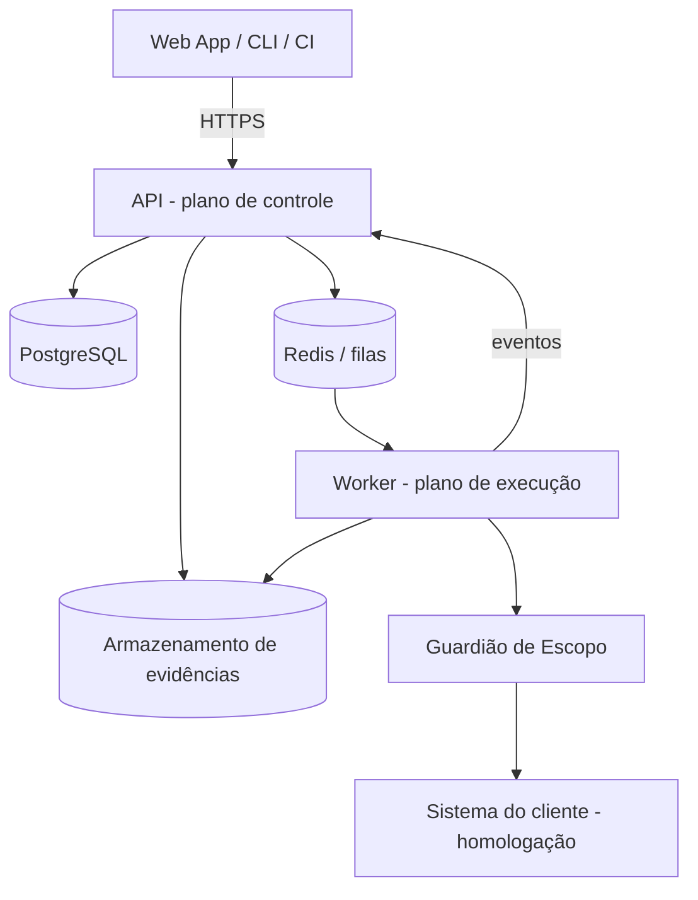
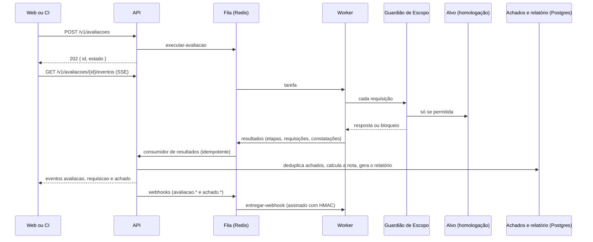

# Bastion — Plataforma de avaliação de segurança contínua

> Nome provisório. Este README é a fonte única de documentação do projeto.

## 1. Objetivo principal

SaaS que faz **avaliações de segurança autorizadas e contínuas** em sites, APIs, sistemas internos e apps com IA. O cliente cadastra um sistema, comprova que é dono dele, agenda ou dispara avaliações (inclusive pelo CI) e recebe **achados com evidência, severidade e correção sugerida**, mapeados para OWASP e LGPD.

Regras inegociáveis do produto:
- Só avalia sistemas com **propriedade comprovada** (DNS TXT, arquivo em `/.well-known/` ou cabeçalho com token).
- **Nunca produção**: só ambientes de homologação do cliente ou ambientes isolados criados pela plataforma.
- Todo tráfego de saída passa pelo **Guardião de Escopo**, e toda ação fica no **log de auditoria**.

## 2. Como rodar

Pré-requisitos: **Node ≥ 24** (há um `.nvmrc`) e pnpm via corepack (a versão fica fixada em `packageManager`).

Na primeira vez, em cada máquina, habilite o corepack. No Windows, isso pode exigir um terminal aberto como administrador:

```bash
corepack enable           # deixa o comando pnpm disponível no PATH, na versão fixada
```

```bash
pnpm install              # instala as dependências do monorepo
pnpm dev                  # web (3000), API (3333) e worker; exige a infraestrutura da seção abaixo
pnpm build                # build de produção
pnpm typecheck            # verificação de tipos (TypeScript estrito)
pnpm lint                 # ESLint
```

> Sem `corepack enable`, `corepack pnpm dev` na raiz falha com "pnpm não é reconhecido", porque o script interno chama `pnpm`. Nesse caso, rode direto: `corepack pnpm --filter @bastion/web dev`.

Para continuar o desenvolvimento em outra máquina, veja a seção 9.2.

O protótipo da Fase 1 (dados fictícios em memória) foi removido (ADR 16): o web agora depende da API, do banco e do worker.

### Plataforma (Fase 2)

Pré-requisito extra: **Docker Desktop** em execução.

```bash
cp .env.example .env      # valores só de desenvolvimento
pnpm infra:subir          # Postgres, Redis, armazenamento S3 e alvo de teste
pnpm banco:migrar         # migrações geradas + SQL manual (RLS, permissões, auditoria)
pnpm banco:semear         # dados iniciais (idempotente; credenciais abaixo)
pnpm dev                  # web (3000), API (3333) e worker
pnpm test                 # testes de todos os pacotes
pnpm infra:parar          # derruba os contêineres (os volumes ficam)
```

| Porta | Serviço |
|---|---|
| 3000 | Web (Next.js) |
| 3333 | API (Fastify) |
| 5432 | PostgreSQL 18 (bancos `bastion` e `bastion_teste`) |
| 6379 | Redis 8 |
| 9000 / 9001 | Armazenamento S3 (RustFS) / console |
| 8443 / 8080 | Alvo de teste (HTTPS / HTTP) |

API e worker rodam no host; o Compose só sobe a infraestrutura de desenvolvimento.

**Credenciais do semeador** (só desenvolvimento). O `pnpm banco:semear` cria a "Organização Exemplo" e o sistema "Alvo de teste local" (`https://localhost:8443`, domínio de produção declarado `producao.exemplo.com.br`, verificação por arquivo `.well-known`). O token de verificação é gravado em `infra/alvo-de-teste/publico/.well-known/bastion-verificacao.txt`.

| Papel | E-mail | Senha |
|---|---|---|
| DONO | `dono@exemplo.com.br` | `bastion-demo-123` |
| ANALISTA | `analista@exemplo.com.br` | `bastion-demo-123` |
| LEITOR | `leitor@exemplo.com.br` | `bastion-demo-123` |

**Chromium do Playwright** (uma vez por máquina; necessário para o PDF do relatório, que sem ele responde 503 `PDF_INDISPONIVEL`):

```bash
pnpm --filter @bastion/api exec playwright install chromium
```

Em redes corporativas com inspeção de TLS, o download pode falhar com `SELF_SIGNED_CERT_IN_CHAIN`. Nesse caso, faça o Node confiar no repositório de certificados do sistema só nesse comando: no PowerShell, `$env:NODE_OPTIONS="--use-system-ca"; pnpm --filter @bastion/api exec playwright install chromium; Remove-Item Env:NODE_OPTIONS`. No bash, `NODE_OPTIONS=--use-system-ca pnpm --filter @bastion/api exec playwright install chromium`. Nunca desligue a verificação de TLS.

**Testes de integração** (precisam do Postgres e do Redis do Compose, com o banco de teste migrado por `pnpm banco:migrar:teste`):

```bash
pnpm --filter @bastion/api test:integracao      # usa o banco bastion_teste (DATABASE_URL_TESTE e DATABASE_URL_TESTE_MIGRACAO do .env)
pnpm --filter @bastion/worker test:integracao   # worker contra o alvo de teste e o Redis
```

Os da API sobem a aplicação com `app.inject`, filas e armazenamento falsos, esvaziam as tabelas a cada teste com o papel migrador e dependem de `.env` na raiz. O teste de PDF real só roda se o Chromium estiver instalado. Os testes unitários (`pnpm test`) não precisam de banco.

**Testes de tela** (Playwright, em `apps/web/e2e`): exigem **API, worker e web no ar** (`pnpm dev`), o Compose de pé e o banco **semeado** (`pnpm banco:semear`).

```bash
pnpm --filter @bastion/web test:e2e
```

**Alvo de teste.** `https://localhost:8443` (e `http://localhost:8080`) é um nginx **propositalmente mal configurado**, o único alvo dos testes ponta a ponta. Usa certificado autoassinado de 20 dias e tem falhas de propósito: versão do servidor exposta, `X-Powered-By` vazando a versão do PHP, cookie sem `HttpOnly`, `Secure` e `SameSite`, e nenhum cabeçalho de segurança (CSP, HSTS, X-Content-Type-Options, X-Frame-Options, Referrer-Policy, Permissions-Policy). Os testes gravam `bastion-verificacao.txt` em `infra/alvo-de-teste/publico/.well-known/`. Como ele roda em rede privada, o `.env` traz `GUARDIAO_PERMITIR_REDES_PRIVADAS=true`, que é **só para dev e proibido em produção**.

> Aviso: os papéis do Postgres (`bastion_migrador`, `bastion_app`) e as credenciais do S3 usam senhas de desenvolvimento, versionadas em `infra/` e no `.env.example`. Nunca as reutilize fora da máquina local.

## 3. Tecnologias

### Em uso

| Camada | Escolha |
|---|---|
| Monorepo | pnpm workspaces (`apps/*`, `packages/*`) |
| Linguagem | TypeScript 6.0 estrito (sem `any`), Node ≥ 24 |
| Front | Next.js 16.4 (App Router, Turbopack) + React 19.3 |
| Estilo | CSS puro com tokens (`globals.css`), tema "Sinalização" |
| API | Fastify 5.12 + `fastify-type-provider-zod` 7 |
| Contratos | Zod 4.6 (`packages/contratos`), compartilhado entre API, worker e web |
| Banco | PostgreSQL 18 (isolamento por organização com RLS) |
| Acesso a dados | Drizzle ORM 0.45 + drizzle-kit + `pg`, com SQL manual para RLS (ADR 10) |
| Fila | BullMQ 6.7 + ioredis 6 sobre Redis 8.8 |
| Worker | Node + undici 8 (cliente HTTP do Guardião, com DNS fixado) |
| Arquivos | S3 ou compatível: RustFS no dev (ADR 9), via `@aws-sdk/client-s3` |
| PDF | Playwright 1.65 (Chromium sem rede, ADR 13) |
| Testes | Vitest 5.1 (unitários e de integração) + Playwright 1.65 (telas) |
| Dev local | Docker Compose (Postgres, Redis, RustFS, alvo de teste e alvo vulnerável de laboratório, Node puro, porta 8081, inseguro de propósito) |
| Qualidade | ESLint 9 |

## 4. Arquitetura e decisões

### 4.1 Visão geral



- **Plano de controle:** contas, sistemas, avaliações, achados, relatórios e auditoria.
- **Plano de execução:** worker que consome a fila e executa os módulos de avaliação. Ele roda isolado e só fala com a internet pelo Guardião de Escopo.
- **Guardião de Escopo:** só libera requisições para alvos verificados da organização, aplica limite de taxa, bloqueia domínios declarados como produção e registra tudo.

### 4.2 Contextos delimitados (DDD) e estrutura de pastas

Organizar **por contexto de negócio**, não por tipo técnico.

| Contexto | Agregado raiz | Objetos de valor | Eventos |
|---|---|---|---|
| Contas e Acessos | `Organizacao` (+ `Membro`) | `Papel`, `Email` | `MembroConvidado` |
| Sistemas e Autorização | `Sistema` | `VerificacaoDePropriedade`, `Escopo`, `CredencialDeTeste` | `SistemaVerificado` |
| Avaliações | `Avaliacao` (+ `Etapa`) | `PerfilDeAvaliacao`, `EstadoDaAvaliacao`, `Agenda` | `AvaliacaoSolicitada`, `AvaliacaoConcluida` |
| Achados | `Achado` (+ `HistoricoDoAchado`) | `Severidade`, `Evidencia`, `ImpressaoDigital` | `AchadoCriado`, `AchadoCorrigido` |
| Relatórios | `Relatorio` | `NotaDeSeguranca`, `MapeamentoDeConformidade` | `RelatorioGerado` |
| Auditoria | `RegistroDeAuditoria` (só inclusão) | `Ator`, `Acao` | — |

Estrutura real do monorepo:

```
apps/
  web/                         Next.js: telas que consomem a API
    src/app/                   rotas (App Router) e globals.css (tokens e classes)
    src/api/                   cliente tipado da API e sessão
    src/componentes/           componentes compartilhados
    e2e/                       testes de tela (Playwright)
  api/                         Fastify: plano de controle
    migracoes/
      geradas/                 SQL do drizzle-kit
      manuais/                 RLS, permissões e auditoria só inclusão (idempotente)
    scripts/                   migrar.ts e semear.ts
    src/
      contas/ sistemas/ avaliacoes/ achados/ relatorios/ auditoria/ painel/
        dominio/               agregados, objetos de valor, eventos e regras (sem framework)
        aplicacao/             casos de uso (ServicoDe...)
        infraestrutura/        tabelas Drizzle, repositórios e rotas Fastify
      integracoes/             camada anticorrupção: filas (BullMQ), armazenamento S3, consumidor de resultados
      compartilhado/           config, erros, autenticação, conexão com RLS, outbox, testes de apoio
      aplicacao.ts             monta a aplicação Fastify
      rotas.ts                 serviços e rotas de cada contexto
      servidor.ts              ponto de entrada
  worker/src/                  plano de execução: sem acesso ao banco nem ao S3
    guardiao-de-escopo/        regras, DNS seguro, cliente HTTP, limite de taxa, sonda TLS
    modulos/passivo/           cabeçalhos, TLS, cookies, exposição de versão
    tarefas/                   consumidores: executar-avaliacao, verificar-propriedade, entregar-webhook
packages/
  dominio-compartilhado/       ErroDeDominio, Email, Severidade, ImpressaoDigital, Papel, evento de domínio
  contratos/                   esquemas Zod da API /v1, das filas e dos webhooks
infra/
  alvo-de-teste/               nginx propositalmente mal configurado
  postgres/init/               criação dos bancos e papéis
docker-compose.yml             Postgres, Redis, RustFS e alvo de teste
```

#### Fluxo de uma avaliação



Em texto: web ou CI chamam a API; a API enfileira a tarefa; o worker consome, passa cada requisição pelo Guardião e só então chega ao alvo; os resultados voltam pela fila `resultados`; a API os persiste, agrupa os achados, gera o relatório e publica os eventos para o SSE e para os webhooks.

### 4.3 Ciclo de vida da avaliação (máquina de estados)

`RASCUNHO → AGUARDANDO_VERIFICACAO → NA_FILA → PREPARANDO → EM_EXECUCAO → ANALISANDO → CONCLUIDA | FALHOU | CANCELADA`

- Só o agregado `Avaliacao` muda o próprio estado. Transição inválida lança erro de domínio.
- Cada transição grava um evento (outbox) e um registro de auditoria.
- Limites: `PREPARANDO` tem tempo máximo de 20 min; `EM_EXECUCAO` tem tempo máximo por perfil e pode ser cancelada a qualquer momento (botão Parar).

### 4.4 Ciclo de vida do achado

`NOVO → CONFIRMADO → EM_CORRECAO → REVALIDANDO → CORRIGIDO | REABERTO | RISCO_ACEITO`

- `RISCO_ACEITO` exige justificativa, responsável e data de validade. Quando vence, volta para `CONFIRMADO`.
- Achados repetidos entre avaliações são agrupados pela `ImpressaoDigital` (sistema + tipo + local).

### 4.5 Decisões de arquitetura (ADRs)

| # | Contexto | Decisão | Consequência |
|---|---|---|---|
| 1 | Time pequeno, domínio ainda em descoberta | Monólito modular (API) + worker separado | Extrair serviços depois, começando pela execução |
| 2 | Worker comprometido não pode alcançar dados | Controle e execução em processos e redes separados; comunicação por fila | Mais uma peça para operar |
| 3 | Contextos precisam reagir a eventos sem acoplamento | Eventos de domínio com padrão outbox | Consumidores idempotentes |
| 4 | Isolamento entre clientes | `organizacao_id` em todas as tabelas + Row-Level Security | Toda consulta passa pelo contexto da organização |
| 5 | Nunca avaliar produção | Domínio de produção declarado entra na lista de bloqueio do Guardião | Cadastro de sistema exige esse campo |
| 6 | Tema "Sinalização" simples, de alto contraste e sem dependências; a rede do ambiente de build pode ser restrita | CSS puro com tokens em `globals.css`, sem Tailwind e sem `next/font` | Os tokens (únicas cores em hex) vivem em um só `:root`; o resto usa `var(--token)`. Classes utilitárias próprias (`.btn`, `.card`, `.tag`...) precisam ser mantidas à mão |
| 7 | Validar telas e fluxos antes de existir a API | Protótipo com dados fictícios em memória, usando as mesmas máquinas de estado e a mesma linguagem ubíqua do domínio | Telas migram para a API real trocando o armazém; tudo se perde ao recarregar a página |
| 8 | TypeScript 7.0 já existe, mas o ecossistema do Next 16 foi validado com a série 6 | Usar TypeScript 6.0 (`~6.0.3`) | Atualizar para 7.x só depois de confirmar a compatibilidade com Next e ESLint |
| 9 | O repositório oficial `minio/minio` saiu do Docker Hub, e o dev precisa de um armazenamento compatível com S3 | RustFS (`rustfs/rustfs:1.0.5`) no Docker Compose, acessado só pelo SDK S3 | Trocar por S3, MinIO ou outro compatível é só configuração (`S3_*` no `.env`) |
| 10 | Precisamos de migrações versionadas, tipos fortes e RLS do Postgres, que ORMs não declaram | Drizzle ORM + drizzle-kit: tabelas em TypeScript, SQL gerado e versionado; RLS, permissões e a regra "auditoria só inclusão" em SQL manual idempotente (`apps/api/migracoes/manuais`). Papéis separados: `bastion_migrador` (dono) e `bastion_app` (sem `BYPASSRLS`) | Tabelas de autenticação (`usuarios`, `sessoes`, `chaves_de_api`) e do outbox (`eventos_de_saida`, `eventos_processados`) são globais, sem RLS: são lidas antes de existir o contexto da organização (login, chave de API) ou pelo worker, e seus repositórios sempre filtram por `organizacao_id` ao listar. Toda mudança de RLS exige um novo arquivo manual |
| 11 | O web precisa de login revogável sem expor token ao JavaScript, e o CI precisa de uma credencial própria | Web: cookie de sessão **opaco** (`HttpOnly`, `SameSite=Lax`), guardado como hash no banco, com senha em Argon2id. CI e integrações: chave `bst_<prefixo>_<segredo>` em `Authorization: Bearer`, guardada só como hash SHA-256, ligada a uma organização e a um papel | Sessão e chave podem ser revogadas na hora. O segredo da chave aparece uma única vez. Quem manda `Authorization` ignora o cookie |
| 12 | Prazos (tempo máximo da avaliação e vencimento do risco aceito) precisam disparar sozinhos, mas o RLS impede uma varredura que enxergue várias organizações | **Jobs atrasados** na fila `vigilancia` do BullMQ, agendados quando o prazo nasce (`tempo-limite-da-avaliacao` e `vencimento-do-risco`). Ao disparar, a API abre uma transação **no contexto da organização** e confere o estado | Nenhum processo precisa de acesso global ao banco. O job é só um despertador: se o estado mudou, ele não faz nada. Prazos muito longos dependem do atraso máximo do Redis/BullMQ (cerca de 24 dias por job) |
| 13 | O relatório precisa virar PDF, mas o worker não tem acesso a dados e o Chromium é pesado | PDF gerado **sob demanda** na API, com Chromium do Playwright **sem rede** (toda requisição é abortada), a partir do HTML autocontido do relatório. O resultado é guardado no S3 (`relatorios/<organizacaoId>/<id>.pdf`) e reutilizado | O primeiro acesso é mais lento. Exige `playwright install chromium` na máquina e na imagem da API; sem ele, a rota devolve 503 `PDF_INDISPONIVEL`. O HTML não referencia nada externo |
| 14 | O usuário precisa saber na hora se a propriedade do sistema foi comprovada, mas a saída para a internet é só do worker | A API enfileira `verificar-propriedade` e **espera o retorno do job por até 20 s**, fora de qualquer transação. Depois grava o resultado no agregado `Sistema` | Resposta direta na tela. Se o worker estiver parado ou lento, a API responde 504 `VERIFICACAO_DEMOROU` |
| 15 | Evidências são pequenas (requisição, resposta, observação) e o worker não deve receber credenciais do S3 | **Evidências inline**, até 8 KB por campo (com marca `[truncado]`), dentro do próprio achado. O S3 guarda só os PDFs | Uma peça a menos para operar e o worker continua sem acesso a dados. Evidências grandes (capturas, HAR) exigirão rever esta decisão |
| 16 | Com a API pronta, o armazém fictício em memória não tem mais função e dobraria a lógica | **Remoção** de `apps/web/src/prototipo`: todas as telas consomem a API, e os mesmos contratos Zod tipam as duas pontas | Não há "modo demonstração": para demonstrar, use o semeador (`pnpm banco:semear`) |
| 17 | Pentest autorizado exige ir além da análise passiva, sem risco para o alvo | **Perfis de avaliação ativos** `PADRAO`, `COMPLETO` e `IA`, com sondas não destrutivas. Exigem autorização por escrito do dono do sistema, consentimento explícito para criar dados, freios por perfil e disjuntor, e tudo é auditado | Mais poder, mais responsabilidade: sem autorização registrada o perfil não inicia. Avaliações ativas são mais lentas e geram mais tráfego no alvo |
| 18 | Os módulos ativos precisam de um alvo para testes, mas apontá-los a sistemas reais seria arriscado | **Alvo vulnerável de laboratório** (`infra/alvo-de-teste/app-vulneravel`): Node puro, sem dependências, tudo simulado em memória, serviço `alvo-vulneravel` na porta 8081 | Falhas propositais: é fixture local de dev e testes, **jamais** vai para produção nem fica exposto à internet |
| 19 | Credenciais de teste e cabeçalhos do conector de IA são segredos do cliente guardados no banco | Cifragem **AES-256-GCM** na API (`compartilhado/cifragem.ts`), formato `v1.<iv>.<tag>.<texto>` em base64url, chave em `CHAVE_DE_CIFRAGEM` (32 bytes). O domínio guarda só o valor opaco; a API decifra apenas ao montar a tarefa do worker, e a API nunca devolve esses segredos | Perder ou trocar a chave exige recadastrar credenciais e conectores. Em produção a variável é obrigatória; em dev há uma chave fixa pública |

Como os perfis ativos chegam ao worker: ao solicitar a avaliação, a API confere a autorização e o perfil, monta o escopo (métodos permitidos, caminhos excluídos, teto de requisições, permissão de criação de dados) e, no `COMPLETO`, inclui a credencial de teste decifrada; no `IA`, o conector decifrado. Esses segredos seguem só pela fila e nunca vão para log, auditoria, DTO ou relatório.

#### Segurança dos perfis ativos

Salvaguardas valem para qualquer avaliação ativa:

- **Escopo preso à propriedade verificada:** só se sonda o que pertence ao sistema com propriedade comprovada.
- **Produção bloqueada:** o domínio de produção declarado segue na lista de bloqueio do Guardião (ADR 5).
- **Não destrutivo por padrão:** as sondas apenas observam; nada é apagado ou alterado.
- **Criação de dados só com consentimento:** exige autorização explícita e os valores criados levam marca identificável.
- **Limites por perfil:** cada perfil tem teto de requisições, ritmo e duração.
- **Disjuntor:** erros ou sinais de degradação do alvo interrompem a avaliação.
- **Autorização por escrito obrigatória:** registrada antes de iniciar, e tudo fica na auditoria.
- **Alvo de laboratório:** `alvo-vulneravel` (porta 8081) é inseguro de propósito, só para dev e testes; nunca em produção.

## 5. Escopo do MVP

### Fase 1: protótipo navegável
Telas em `apps/web` com **dados fictícios em memória**, no tema **Sinalização** (seção 7):
Login · Painel · Sistemas · Cadastro de sistema (com passo de verificação) · Nova avaliação · Avaliação ao vivo · Lista de achados · Detalhe do achado · Relatório · Integrações · Equipe e auditoria · Plano e cobrança.

### Fase 2: plataforma real
- Contas, organizações, membros e papéis (Dono, Admin, Analista, Desenvolvedor, Leitor). Login por e-mail e senha no MVP; OIDC depois.
- Cadastro de sistemas, verificação de propriedade e domínio de produção bloqueado.
- Avaliações com a máquina de estados, fila e progresso ao vivo (WebSocket ou SSE).
- **Primeiro módulo de avaliação, passivo e não intrusivo:** cabeçalhos de segurança HTTP, configuração TLS e certificado, flags de cookies (`Secure`, `HttpOnly`, `SameSite`) e exposição de informação de versão em cabeçalhos.
- Achados com deduplicação e ciclo de vida; nota de segurança de 0 a 100.
- Relatório HTML e PDF; auditoria; API pública `/v1` (seção 6).
- Testes unitários do domínio (máquinas de estado, objetos de valor, regras de escopo).

Plano de execução detalhado na seção 9.

### Fora do MVP
Módulos de IA (chatbots e agentes), ambientes isolados criados pela plataforma, integrações Jira, Teams e Slack, cobrança real e SSO SAML.

## 6. API pública /v1

A API (Fastify, porta 3333) fala JSON. Os esquemas de entrada e saída ficam em `packages/contratos` (Zod) e são os mesmos que o web usa. Datas são ISO 8601; ids são UUID.

### 6.1 Autenticação

- **Cookie de sessão** (`bastion_sessao`, `HttpOnly`): criado por `POST /v1/organizacoes`, `POST /v1/sessao` e `POST /v1/convites/aceitar`. É o que o web usa.
- **Chave de API**: `Authorization: Bearer bst_...`. A chave tem organização e papel próprios e o segredo aparece uma única vez, na criação.
- Se a requisição trouxer o cabeçalho `Authorization`, o cookie é ignorado.
- `X-Bastion-Origem: CI` em `POST /v1/avaliacoes` marca a avaliação como vinda do CI. Sem o cabeçalho, a origem é `WEB` (sessão) ou `API` (chave).
- Cada rota exige uma **permissão** (tabela de papéis na seção 8.9). Sem credencial, a resposta é 401; com credencial sem a permissão, 403.

### 6.2 Formato de erro e status

Todo erro tem o mesmo formato:

```json
{ "erro": { "codigo": "VALIDACAO", "mensagem": "Os dados enviados são inválidos.", "detalhes": [{ "campo": "senha", "mensagem": "..." }] } }
```

`detalhes` é opcional. A `mensagem` é sempre em português e pode ser mostrada ao usuário.

| Status | Quando |
|---|---|
| 400 | Corpo, parâmetro ou consulta inválidos (`VALIDACAO`), cursor de paginação inválido (`CURSOR_INVALIDO`) |
| 401 | Sem sessão ou chave válida (`NAO_AUTENTICADO`) |
| 403 | O papel não tem a permissão (`PERMISSAO_NEGADA`) |
| 404 | Recurso inexistente ou de outra organização (`NAO_ENCONTRADO`), rota inexistente |
| 409 | Conflito, como e-mail já cadastrado |
| 422 | Regra de negócio violada: transição de estado inválida, validade do risco no passado, sistema sem propriedade verificada, achado fora de `EM_CORRECAO` ao revalidar |
| 429 | Limite de taxa (300 requisições por minuto; 10 por minuto em login e aceite de convite) |
| 503 | Dependência indisponível: banco ou Redis (`SERVICO_INDISPONIVEL`) ou Chromium ausente (`PDF_INDISPONIVEL`) |
| 504 | A verificação de propriedade passou de 20 s (`VERIFICACAO_DEMOROU`) |

Listas paginadas devolvem `{ "itens": [...], "proximaPagina": "<cursor>" | null }` e aceitam `?limite=` (1 a 100, padrão 20) e `?pagina=<cursor>`. O cursor é opaco: devolva-o como veio.

### 6.3 Rotas

**Organizações, sessão e convites**

| Rota | Permissão | Descrição | Resposta |
|---|---|---|---|
| `POST /v1/organizacoes` | pública | Cria organização e DONO (`nomeDaOrganizacao`, `nome`, `email`, `senha` com 12+ caracteres) | `201 { usuario, organizacao, papel }` e cookie |
| `POST /v1/sessao` | pública | Entra (`email`, `senha`) | `200 { usuario, organizacao, papel }` e cookie |
| `GET /v1/sessao` | autenticado | Sessão atual | `200 { usuario, organizacao, papel }` |
| `DELETE /v1/sessao` | autenticado | Sai e revoga a sessão | `204` |
| `POST /v1/convites/aceitar` | pública | Aceita convite (`token`, `nome`, `senha`) | `200 { usuario, organizacao, papel }` e cookie |

**Membros, chaves de API, webhooks e plano**

| Rota | Permissão | Descrição | Resposta |
|---|---|---|---|
| `GET /v1/membros` | `LER` | Lista membros | `{ itens: MembroDto[] }` |
| `POST /v1/membros` | `GERENCIAR_MEMBROS` | Convida (`email`, `papel`) | `201 { membro, tokenDoConvite }` |
| `PATCH /v1/membros/{id}` | `GERENCIAR_MEMBROS` | Altera o papel (`papel`) | `200 MembroDto` |
| `DELETE /v1/membros/{id}` | `GERENCIAR_MEMBROS` | Remove o membro | `204` |
| `GET /v1/chaves-de-api` | `GERENCIAR_CHAVES_DE_API` | Lista chaves (sem o segredo) | `{ itens: ChaveDeApiDto[] }` |
| `POST /v1/chaves-de-api` | `GERENCIAR_CHAVES_DE_API` | Cria chave (`nome`, `papel`) | `201 { chave, segredo }` |
| `DELETE /v1/chaves-de-api/{id}` | `GERENCIAR_CHAVES_DE_API` | Revoga | `204` |
| `GET /v1/webhooks` | `GERENCIAR_WEBHOOKS` | Lista webhooks | `{ itens: WebhookDto[] }` |
| `POST /v1/webhooks` | `GERENCIAR_WEBHOOKS` | Cadastra (`url` https, `eventos[]`) | `201 { webhook, segredoDeAssinatura }` |
| `PATCH /v1/webhooks/{id}` | `GERENCIAR_WEBHOOKS` | Ativa ou desativa (`ativo`) | `200 WebhookDto` |
| `DELETE /v1/webhooks/{id}` | `GERENCIAR_WEBHOOKS` | Remove | `204` |
| `GET /v1/plano` | `LER` | Plano, limites e uso | `{ nome, limites, uso }` |

**Sistemas e verificação**

| Rota | Permissão | Descrição | Resposta |
|---|---|---|---|
| `GET /v1/sistemas` | `LER` | Lista sistemas (esconde os arquivados; `?incluirArquivados=true` os mostra) | `{ itens: SistemaDto[] }` |
| `POST /v1/sistemas` | `CADASTRAR_SISTEMA` | Cadastra (`nome`, `tipo`, `urlDeHomologacao`, `dominioDeProducao`, `metodoDeVerificacao`) | `201 { id, estadoVerificacao, verificacao }` |
| `GET /v1/sistemas/{id}` | `LER` | Detalhe, com estado da verificação e última nota | `200 SistemaDto` |
| `GET /v1/sistemas/{id}/verificacao` | `LER` | Token e instruções dos três métodos | `200 { metodo, token, registroDns, arquivo, cabecalho }` |
| `POST /v1/sistemas/{id}/verificacao` | `VERIFICAR_SISTEMA` | Confere a prova de propriedade (corpo opcional `{ metodo }`); espera até 20 s | `200 { verificado, expiraEm, mensagem }` |
| `PUT /v1/sistemas/{id}/credencial-de-teste` | `CADASTRAR_SISTEMA` | Define a conta de teste usada no perfil `COMPLETO` (`modo` `FORMULARIO\|JSON`, `urlDeLogin`, `campoUsuario`, `campoSenha`, `usuario`, `senha`, `indicadorDeSucesso`). Usuário e senha são cifrados | `200 SistemaDto` (só `credencialDeTeste { configurada, modo, urlDeLogin, indicadorDeSucesso }`) |
| `DELETE /v1/sistemas/{id}/credencial-de-teste` | `CADASTRAR_SISTEMA` | Remove a credencial | `200 SistemaDto` |
| `PUT /v1/sistemas/{id}/conector-de-ia` | `CADASTRAR_SISTEMA` | Configura como falar com o app de IA (`url` https, `cabecalhos?`, `modeloDoCorpo` com `{{mensagem}}`, `caminhoDaResposta`, `frasesSigilosas[]`). Só para `tipo` `APP_COM_IA` (senão 422). Cabeçalhos são cifrados | `200 SistemaDto` (só `conectorDeIa { configurado, url, caminhoDaResposta }`) |
| `DELETE /v1/sistemas/{id}/conector-de-ia` | `CADASTRAR_SISTEMA` | Remove o conector | `200 SistemaDto` |
| `POST /v1/sistemas/{id}/arquivar` | `CADASTRAR_SISTEMA` | Arquiva o sistema: some da listagem padrão, deixa de contar no limite do plano, não pode mais ser avaliado (422 `SISTEMA_ARQUIVADO`) e seus agendamentos são pausados | `200 SistemaDto` (`arquivado: true`) |
| `PATCH /v1/sistemas/{id}/metodo` | `VERIFICAR_SISTEMA` | Troca o método de verificação (`{ metodo }`): gera novo token e a verificação volta a `PENDENTE` | `200 { metodo, token, registroDns, arquivo, cabecalho }` |

**Avaliações**

| Rota | Permissão | Descrição | Resposta |
|---|---|---|---|
| `GET /v1/avaliacoes` | `LER` | Lista (`?sistemaId`, `?estado`, paginação) | página de `AvaliacaoDto` |
| `POST /v1/avaliacoes` | `SOLICITAR_AVALIACAO` | Dispara (`sistemaId`, `perfil` `PASSIVO\|PADRAO\|COMPLETO\|IA`, `notaMinima`, `autorizacao { responsavel, referencia }`, `permitirCriacaoDeDados`). Perfis ativos sem `autorizacao` dão 422 `AUTORIZACAO_OBRIGATORIA`; `IA` sem conector ou fora de `APP_COM_IA` dá 422 `PERFIL_INDISPONIVEL`; `permitirCriacaoDeDados` só vale no `COMPLETO`. Sistema arquivado dá 422 `SISTEMA_ARQUIVADO`; acima de 100 avaliações no mês, 422 `LIMITE_DO_PLANO`. A `origem` é `AGENDA` quando a avaliação nasce de um agendamento | `202 { id, estado }` |
| `GET /v1/avaliacoes/{id}` | `LER` | Estado, progresso, etapas, nota, `aprovada`, `relatorioId` e contagem de achados | `200 AvaliacaoDto` |
| `GET /v1/avaliacoes/{id}/requisicoes` | `LER` | Requisições do Guardião, com decisão e motivo | `{ itens: RequisicaoDoGuardiaoDto[] }` |
| `POST /v1/avaliacoes/{id}/parar` | `PARAR_AVALIACAO` | Cancela | `200 { estado: "CANCELADA" }` |
| `GET /v1/avaliacoes/{id}/eventos` | `LER` | Stream SSE (seção 6.4) | `text/event-stream` |
| `GET /v1/avaliacoes/{id}/achados` | `LER` | Achados da avaliação (`?severidade=CRITICA,ALTA`, paginação) | página de `AchadoResumoDto` |

**Agendamentos**

| Rota | Permissão | Descrição | Resposta |
|---|---|---|---|
| `GET /v1/agendamentos` | `LER` | Lista os agendamentos recorrentes, com `sistemaNome`, `autorizacao` e `proximaExecucaoEm` | `{ itens: AgendamentoDto[] }` |
| `POST /v1/agendamentos` | `SOLICITAR_AVALIACAO` | Cria (`sistemaId`, `perfil`, `notaMinima`, `frequencia` `DIARIA\|SEMANAL\|MENSAL`, `horario` `HH:MM`, `diaDaSemana` 0-6 se semanal, `diaDoMes` 1-28 se mensal, `autorizacao` obrigatória em perfil ativo, `permitirCriacaoDeDados`). O sistema precisa estar verificado e não arquivado (422 `SISTEMA_NAO_VERIFICADO` / `SISTEMA_ARQUIVADO`). Horário no fuso `America/Sao_Paulo` | `201 AgendamentoDto` |
| `PATCH /v1/agendamentos/{id}` | `SOLICITAR_AVALIACAO` | Pausa ou retoma (`{ ativo }`) | `200 AgendamentoDto` |
| `DELETE /v1/agendamentos/{id}` | `SOLICITAR_AVALIACAO` | Remove o agendamento e o agendador | `204` |

**Achados**

| Rota | Permissão | Descrição | Resposta |
|---|---|---|---|
| `GET /v1/achados` | `LER` | Lista (`?severidade=CRITICA,ALTA`, `?estado`, `?sistemaId`, `?busca` em título ou local, `?incluirFechados=true`). Ordem: severidade (crítica primeiro) e depois a última ocorrência, da mais recente para a mais antiga. Sem `incluirFechados`, esconde `CORRIGIDO` e `RISCO_ACEITO` | página de `AchadoResumoDto` |
| `GET /v1/achados/{id}` | `LER` | Detalhe com evidência, correção sugerida, OWASP/LGPD, histórico e `transicoesPossiveis` | `200 AchadoDto` |
| `PATCH /v1/achados/{id}` | conforme o destino: `CONFIRMADO` e `REABERTO` pedem `TRIAR_ACHADO`; `EM_CORRECAO`, `CORRIGIR_ACHADO`; `RISCO_ACEITO`, `ACEITAR_RISCO` | Muda o estado (`estado`, `comentario?`, `riscoAceito { justificativa (20+), responsavel, validoAte }` quando `RISCO_ACEITO`). `CORRIGIDO` e `REVALIDANDO` dão 422: use a revalidação | `200 { estado }` |
| `POST /v1/achados/{id}/revalidar` | `CORRIGIR_ACHADO` | Dispara nova avaliação do sistema; o achado precisa estar `EM_CORRECAO` | `202 { avaliacaoId }` |

**Relatórios**

| Rota | Permissão | Descrição | Resposta |
|---|---|---|---|
| `GET /v1/relatorios` | `LER` | Lista (`?avaliacaoId`) | `{ itens: RelatorioResumoDto[] }` |
| `GET /v1/relatorios/{id}` | `LER` | Relatório. O formato vem de `?formato=json\|html\|pdf` ou do cabeçalho `Accept` (`text/html`, `application/pdf`); o padrão é JSON | JSON `RelatorioDto`, `text/html` ou `application/pdf` (`Content-Disposition: inline; filename="relatorio-<id>.pdf"`) |

**Painel, auditoria e saúde**

| Rota | Permissão | Descrição | Resposta |
|---|---|---|---|
| `GET /v1/painel` | `LER` | Nota média, achados em aberto por severidade, sistemas, avaliações recentes e achados críticos e altos | `200 PainelDto` |
| `GET /v1/auditoria` | `VER_AUDITORIA` | Registros (`?ator`, `?acao`, `?busca`, paginação) | página de `RegistroDeAuditoriaDto` |
| `GET /saude` | pública | Confere Postgres e Redis | `200 { ok: true }` ou `503` |

### 6.4 Eventos ao vivo (SSE)

`GET /v1/avaliacoes/{id}/eventos` abre um stream `text/event-stream`. A existência e a permissão são conferidas antes de abrir (erro vira resposta JSON normal). O servidor envia um comentário `: keepalive` a cada 15 s e fecha o stream quando a avaliação chega a um estado final. Cada evento tem o formato `event: <tipo>` e `data: <json>`:

| Evento | Dados | Quando |
|---|---|---|
| `avaliacao` | `AvaliacaoDto` | Ao conectar (estado atual) e a cada mudança de estado, etapa ou progresso |
| `requisicao` | `RequisicaoDoGuardiaoDto` | A cada decisão do Guardião, permitida ou bloqueada |
| `achado` | `AchadoResumoDto` | Quando um achado é criado ou reaparece na avaliação |

No navegador, use `new EventSource(url, { withCredentials: true })`. O `EventSource` não envia cabeçalhos, então no CI prefira consultar `GET /v1/avaliacoes/{id}`.

### 6.5 Webhooks de saída

Eventos: `avaliacao.concluida`, `avaliacao.falhou`, `achado.criado` e `achado.corrigido`. A API entrega um `POST` com este corpo, a partir do worker (o tráfego de saída passa pelo Guardião):

```json
{ "id": "<uuid>", "tipo": "achado.criado", "ocorridoEm": "2026-11-12T10:00:00.000Z", "organizacaoId": "<uuid>", "dados": { } }
```

| Cabeçalho | Conteúdo |
|---|---|
| `X-Bastion-Assinatura` | `sha256=<hex>`: HMAC-SHA256 do **corpo bruto** com o segredo do webhook |
| `X-Bastion-Evento-Id` | Id do evento. O mesmo id pode chegar mais de uma vez: ignore os repetidos |
| `X-Bastion-Evento-Tipo` | Tipo do evento |

Uma resposta fora de 2xx, ou a falta de resposta, é uma falha: a entrega é tentada **até 5 vezes**, com espera exponencial (a partir de 5 s). Responda 2xx rápido e processe depois.

Exemplo de verificação em Node (use o corpo **bruto**, antes de qualquer `JSON.parse`):

```js
import { createHmac, timingSafeEqual } from 'node:crypto';

export function assinaturaConfere(segredo, corpoBruto, cabecalho) {
  const esperado = 'sha256=' + createHmac('sha256', segredo).update(corpoBruto).digest('hex');
  const a = Buffer.from(esperado);
  const b = Buffer.from(cabecalho ?? '');
  return a.length === b.length && timingSafeEqual(a, b);
}
```

### 6.6 Exemplo de uso no CI (curl)

Dispara a avaliação, consulta até um estado final e reprova o build se `aprovada` não for verdadeiro. Defina `BASTION_API`, `BASTION_CHAVE` (segredo do pipeline) e `BASTION_SISTEMA_ID`. Requer `curl` e `jq`.

```bash
#!/usr/bin/env bash
set -euo pipefail
AUTH="Authorization: Bearer ${BASTION_CHAVE}"

ID=$(curl -fsS -X POST "${BASTION_API}/v1/avaliacoes" \
  -H "$AUTH" -H 'X-Bastion-Origem: CI' -H 'Content-Type: application/json' \
  -d "{\"sistemaId\":\"${BASTION_SISTEMA_ID}\",\"perfil\":\"PASSIVO\",\"notaMinima\":80}" | jq -r .id)
echo "Avaliação ${ID} disparada"

for _ in $(seq 1 180); do
  RESP=$(curl -fsS "${BASTION_API}/v1/avaliacoes/${ID}" -H "$AUTH")
  ESTADO=$(jq -r .estado <<<"$RESP")
  case "$ESTADO" in CONCLUIDA|FALHOU|CANCELADA) break ;; esac
  sleep 10
done

NOTA=$(jq -r .nota <<<"$RESP")
APROVADA=$(jq -r .aprovada <<<"$RESP")
echo "Estado: ${ESTADO} | nota: ${NOTA} | aprovada: ${APROVADA}"
if [ "$ESTADO" != "CONCLUIDA" ] || [ "$APROVADA" != "true" ]; then
  echo "Reprovado pelo Bastion. Relatório: ${BASTION_API}/v1/relatorios/$(jq -r .relatorioId <<<"$RESP")?formato=html" >&2
  exit 1
fi
```

## 7. Identidade visual: tema "Sinalização"

Alto contraste, preto e amarelo, cantos retos, títulos em fonte monoespaçada e maiúsculas. **No código, usar sempre `var(--token)`, nunca hex solto.** Os tokens ficam definidos uma única vez em `globals.css`.

```css
:root {
  --bg: #111111;        --surface: #1A1A1A;   --surface-2: #242424;  --border: #3A3A3A;
  --text: #F2F2F2;      --text-2: #B0B0B0;    --muted: #777777;
  --accent: #FFD60A;    /* ação principal (CTA) */
  --accent-2: #FFFFFF;  /* secundária */
  --on-accent: #111111;
  --danger: #FF5C5C;    --warning: #FF9F1C;   --success: #3DDC84;    --info: #5AB0FF;
  --radius: 0;
  --font-body: system-ui, "Segoe UI", Roboto, Helvetica, Arial, sans-serif;
  --font-head: "Cascadia Code", Consolas, monospace;  /* títulos em MAIÚSCULAS */
}
/* Severidade: Crítica=--danger · Alta=--warning · Média=--info · Baixa=--muted */
```

Componentes básicos: `.btn` (`btn-cta`, `btn-outline`, `btn-danger`, `btn-sm`), `.card`, `.tag` de severidade, `.alert` (`info`/`success`/`warning`/`error`), `.table` e `.field`/`.input`/`.label`/`.hint`. Sem gradientes, sem brilho, sem emojis como ícone.

## 8. Guia do usuário

Guia para quem opera a plataforma no dia a dia. Para subir o ambiente local, veja a seção 2; a web fica na porta 3000.

### 8.1 Entrar ou criar a organização

- **Organização nova:** em `/login`, escolha criar conta e informe nome da organização, seu nome, e-mail e senha (mínimo de 12 caracteres). Quem cria a organização vira **DONO**.
- **Organização que já existe:** entre com e-mail e senha. No ambiente de desenvolvimento semeado (`pnpm banco:semear`), use `dono@exemplo.com.br` e `bastion-demo-123` (os outros papéis estão na seção 2).
- **Convite:** quem recebeu um convite abre a tela de aceite com o token, informa nome e senha e entra já com o papel definido. O convite também é enviado por **e-mail** com o link de aceite (em desenvolvimento, o Mailpit captura as mensagens em http://localhost:8025; sem SMTP configurado o envio é pulado). A falha no envio nunca derruba o convite: o token continua sendo devolvido para repassar manualmente.

### 8.2 Cadastrar um sistema

Em **Sistemas → Novo sistema**, informe nome, tipo (site, API, sistema interno ou app com IA), a **URL de homologação** (https) e o **domínio de produção**.

- O domínio de produção é **obrigatório** e fica **bloqueado** para sempre: o Guardião de Escopo recusa qualquer requisição a ele e aos subdomínios.
- A URL de homologação não pode estar dentro do domínio de produção.

### 8.3 Verificar a propriedade

Só sistemas com a propriedade comprovada podem ser avaliados. A tela mostra o token e as instruções dos três métodos; escolha um e clique em **Verificar**:

| Método | O que publicar |
|---|---|
| DNS TXT | Registro TXT em `_bastion-verificacao.<host>` com o valor `bastion-verificacao=<token>` |
| Arquivo | `https://<host>/.well-known/bastion-verificacao.txt` contendo só o token |
| Cabeçalho HTTP | Cabeçalho `X-Bastion-Verificacao: <token>` nas respostas da homologação |

A conferência é feita pelo worker e a tela espera o resultado por até 20 s (ADR 14). Se passar do prazo, confira se o worker está rodando e tente de novo. A verificação vale 90 dias.

**Trocar o método:** escolha outro método na tela do sistema (`PATCH /v1/sistemas/{id}/metodo`). O Bastion gera um novo token e a verificação volta a **pendente**: publique a nova prova e verifique de novo.

**Arquivar um sistema:** use **Arquivar** na tela do sistema. Ele some da lista (use "incluir arquivados" para vê-lo), deixa de contar no limite do plano, não pode mais ser avaliado e seus agendamentos são pausados.

### 8.4 Disparar uma avaliação e acompanhar ao vivo

1. Em **Avaliações → Nova avaliação**, escolha um sistema verificado, o perfil (**Passivo**, **Padrão**, **Completo** ou **IA**) e a **nota mínima** (0 a 100, padrão 70).
   - Escolher um perfil **ativo** (Padrão, Completo, IA) exige **autorização por escrito**: informe o **responsável** e a **referência do escopo** autorizado. Ela fica registrada na avaliação e na auditoria.
   - **Completo** usa a **credencial de teste** cadastrada no sistema (login por formulário; ela é cifrada e nunca é exibida de volta). Sem credencial, roda sem autenticação.
   - **IA** exige um **conector configurado** num sistema do tipo **App com IA** (URL, modelo do corpo com `{{mensagem}}`, caminho da resposta).
   - **Criar dados** de teste só acontece no Completo, com o **consentimento** marcado na própria solicitação.
2. A avaliação entra na fila e a tela mostra, ao vivo, as etapas, o progresso, as **requisições do Guardião** (permitidas e bloqueadas, com o motivo) e os achados à medida que aparecem.
3. O botão **Parar** cancela a avaliação a qualquer momento (a permissão é `PARAR_AVALIACAO`).
4. Ao terminar, a avaliação mostra a nota, se foi **aprovada** (nota ≥ nota mínima) e o link do relatório.

#### Agendamento recorrente

Em **Agendamentos** (`/agendamentos`), crie uma execução recorrente para um sistema **verificado**: escolha o perfil, a nota mínima, a frequência (**diária**, **semanal** com o dia da semana ou **mensal** com o dia 1 a 28) e o horário (fuso de São Paulo). Perfis ativos exigem a autorização por escrito, como na avaliação manual. Cada disparo cria uma avaliação com origem **Agenda**. É possível **pausar**, **retomar** e **remover**; a tela mostra a próxima execução.

**Limites do plano (Profissional):** 10 sistemas ativos, 100 avaliações por mês e 10 membros. Passar do limite devolve 422 `LIMITE_DO_PLANO`. Um agendamento cujo disparo estoura o limite mensal é **pulado e auditado** (`AGENDAMENTO_PULADO_POR_LIMITE`), sem criar avaliação.

### 8.5 Tratar os achados

Em **Achados**, filtre por severidade, estado, sistema ou texto (título ou local). Por padrão os achados **corrigidos** e com **risco aceito** ficam escondidos; marque "incluir fechados" para vê-los.

Fluxo normal:

1. **Confirmar** (`TRIAR_ACHADO`): `NOVO → CONFIRMADO`.
2. **Iniciar correção** (`CORRIGIR_ACHADO`): `CONFIRMADO → EM_CORRECAO`.
3. **Revalidar** (`CORRIGIR_ACHADO`): dispara uma nova avaliação. Se o problema não aparecer mais, o achado vira `CORRIGIDO`; se aparecer, volta para `REABERTO`. **Não existe botão "marcar como corrigido"**: o achado só é corrigido depois de uma nova avaliação.

**Aceitar o risco** (`ACEITAR_RISCO`): exige **justificativa** (pelo menos 20 caracteres), **responsável** e **validade** (data futura). O achado deixa de contar na nota. Ao vencer, volta sozinho para `CONFIRMADO` (ADR 12).

Achados repetidos entre avaliações são agrupados: o mesmo problema, no mesmo local e no mesmo sistema, soma ocorrências em vez de criar outro achado.

### 8.6 Relatório

Cada avaliação concluída gera um relatório com nota, aprovado ou reprovado, resumo, achados por severidade, mapeamento OWASP e LGPD e o escopo avaliado. Abra em **Relatórios**:
- **HTML:** `GET /v1/relatorios/{id}?formato=html`, pronto para imprimir.
- **PDF:** `GET /v1/relatorios/{id}?formato=pdf`. Gerado na primeira vez e guardado para as próximas (ADR 13). A primeira geração de cada PDF pode levar de 10 a 30 segundos (inicialização do Chromium); as seguintes vêm do armazenamento S3 em menos de 1 segundo. Se o Chromium não estiver instalado, a API responde 503 com o comando de instalação.

### 8.7 Integrar ao CI

1. Em **Integrações → Chaves de API**, crie uma chave com o papel mínimo necessário (para avaliar, `DESENVOLVEDOR` basta). O segredo `bst_...` aparece **uma única vez**.
2. Guarde-o como segredo do pipeline e use o exemplo da seção 6.6, que dispara a avaliação, espera o estado final e reprova o build quando `aprovada` for falso.
3. Envie `X-Bastion-Origem: CI` para a avaliação ser marcada com a origem CI.

### 8.8 Webhooks

Em **Integrações → Webhooks**, informe uma URL **https** e os eventos desejados. O segredo de assinatura aparece uma única vez. O receptor deve conferir `X-Bastion-Assinatura` (exemplo na seção 6.5) e ignorar eventos com `X-Bastion-Evento-Id` repetido. É possível desativar e remover o webhook a qualquer momento.

### 8.9 Equipe e papéis

Em **Equipe**, convide membros, altere papéis e remova acessos. Papéis e permissões:

| Permissão | DONO | ADMIN | ANALISTA | DESENVOLVEDOR | LEITOR |
|---|:-:|:-:|:-:|:-:|:-:|
| `LER` (painel, sistemas, avaliações, achados, relatórios) | sim | sim | sim | sim | sim |
| `SOLICITAR_AVALIACAO` | sim | sim | sim | sim | não |
| `CORRIGIR_ACHADO` (iniciar correção e revalidar) | sim | sim | sim | sim | não |
| `PARAR_AVALIACAO` | sim | sim | sim | não | não |
| `CADASTRAR_SISTEMA` e `VERIFICAR_SISTEMA` | sim | sim | sim | não | não |
| `TRIAR_ACHADO` (confirmar e reabrir) | sim | sim | sim | não | não |
| `ACEITAR_RISCO` | sim | sim | sim | não | não |
| `GERENCIAR_MEMBROS`, `GERENCIAR_CHAVES_DE_API`, `GERENCIAR_WEBHOOKS` | sim | sim | não | não | não |
| `VER_AUDITORIA` | sim | sim | não | não | não |

### 8.10 Auditoria

Em **Equipe → Auditoria** (permissão `VER_AUDITORIA`), consulte quem fez o quê e quando: cadastro de sistemas, verificações, avaliações, mudanças de estado de achados, aceites de risco, relatórios gerados, chaves, webhooks e membros. Filtre por ator, ação ou texto. O log é **só de inclusão**: nem a API nem o banco permitem alterar ou apagar registros.

## 9. Fase 2 (plataforma real): plano e execução

> **Status: executado.** O plano foi escrito em 2026-11-11 e executado em quatro levas. O conteúdo definitivo está nas seções 2 a 8. Daqui em diante, as subseções 9.1 a 9.11 são o histórico do plano original: onde o plano e o código divergem, vale o que a seção 9.0 registra.

### 9.0 O que foi entregue e o que mudou em relação ao plano

**Entregue por leva**

| Leva | Entrega |
|---|---|
| 1 | Domínio puro com testes (Avaliações, Achados, Relatórios, Contas, Sistemas, Auditoria), pacotes `contratos` e `dominio-compartilhado`, Docker Compose, migrações com RLS e papéis separados, alvo de teste mal configurado |
| 2 | API núcleo (sessão por cookie, chaves `bst_`, contas, membros, sistemas, verificação de propriedade, auditoria, outbox, webhooks), worker (Guardião de Escopo, módulo passivo, entrega de webhooks, verificação de propriedade) e as telas de login, cadastro, convite, sistemas, equipe, integrações e plano ligadas à API |
| 3 | Avaliações com SSE e vigilância de prazos, achados (deduplicação, ciclo de vida, risco aceito, revalidação), relatórios em JSON, HTML e PDF, painel, consumidor de resultados, telas de avaliação, achados e relatório, remoção do armazém fictício, testes de tela e o README final |
| 4 | Verificação integrada: typecheck, lint, testes unitários e de integração e o fluxo ponta a ponta contra o alvo de teste |

**Desvios em relação ao plano** (todos registrados nas ADRs 9 a 16):
- **Drizzle em vez de Kysely** (ADR 10): migrações geradas pelo drizzle-kit, mais SQL manual para RLS, permissões e a regra "auditoria só inclusão".
- **RustFS em vez de MinIO** (ADR 9): o repositório oficial do MinIO saiu do Docker Hub; o acesso é só pelo SDK S3.
- **Evidências inline** (ADR 15): até 8 KB por campo, dentro do próprio achado; o S3 guarda só os PDFs. O worker, portanto, não recebe URLs pré-assinadas.
- **Vigilância de prazos por jobs atrasados** (ADR 12): em vez de uma varredura periódica, que o RLS impediria.
- **Verificação de propriedade síncrona** (ADR 14), aguardando o retorno do job, em vez de um evento assíncrono na fila `resultados`.

**Pendências conhecidas**
- **Agendador recorrente:** só há disparo manual, pela API e pelo CI. O tipo `Agenda` existe no domínio, mas nada o executa.
- **Limites do plano não aplicados:** `GET /v1/plano` mostra limites e uso, mas a API não bloqueia quem os excede.
- **E-mail de convite:** o convite devolve `tokenDoConvite` na resposta e ninguém envia e-mail; quem convida repassa o token.
- **OIDC:** só há login por e-mail e senha.
- **Redes separadas em produção:** o Compose de desenvolvimento roda tudo no host. Em produção, API, worker, Postgres e Redis devem ficar em redes separadas (ADR 2), e o worker só pode sair para a internet.
- **Fora do escopo desta fase:** módulos de avaliação além do passivo, módulos de IA e ambientes isolados (seção 5).

### 9.1 Objetivo

Trocar o protótipo em memória pela plataforma real:
- API Fastify (plano de controle) e worker (plano de execução), com Postgres, Redis e MinIO via Docker Compose;
- contextos DDD da seção 4.2, organizados por pasta de negócio;
- máquinas de estado da avaliação e do achado testadas com Vitest;
- verificação de propriedade e Guardião de Escopo bloqueando domínios de produção;
- primeiro módulo de avaliação, só passivo;
- achados com deduplicação, relatório HTML/PDF, auditoria e API `/v1`.

### 9.2 Retomar em outra máquina

```bash
git clone https://github.com/Le3Dev/bastion.git
cd bastion
git checkout feature/prototipo-navegavel   # ou main, depois do merge do PR da Fase 1
corepack enable                            # uma vez por máquina (veja a seção 2)
pnpm install
pnpm dev                                   # protótipo na porta 3000
```

- **Pré-requisitos extras da Fase 2:** Docker Desktop (Compose v2) e o Chromium do Playwright (`pnpm --filter @bastion/api exec playwright install chromium`).
- **Branches:** uma branch e um PR por leva (ex.: `feature/fase2-dominio`, `feature/fase2-api-nucleo`), sempre criadas a partir da `main` atualizada.
- **Commits:** Conventional Commits em português, um por feature. Nunca commit direto na `main`.

### 9.3 Estrutura alvo

```
apps/
  web/                         Next.js (as telas passam a consumir a API)
  api/
    migracoes/                 SQL versionado
    src/
      contas/ sistemas/ avaliacoes/ achados/ relatorios/ auditoria/
        dominio/               agregados, objetos de valor, eventos e regras (sem framework)
        aplicacao/             casos de uso
        infraestrutura/        repositórios (Drizzle) e rotas (Fastify)
      integracoes/             camada anticorrupção: filas do worker, armazenamento de evidências
      compartilhado/           config, erros HTTP, contexto da organização (RLS), outbox
      servidor.ts
  worker/src/
    guardiao-de-escopo/        regras de escopo + cliente HTTP protegido
    modulos/passivo/           cabeçalhos, TLS, cookies, exposição de versão
    tarefas/                   consumidores das filas
packages/
  dominio-compartilhado/       ErroDeDominio, Email, Severidade, ImpressaoDigital, Papel
  contratos/                   esquemas Zod e tipos da API /v1 e das mensagens das filas
infra/
  alvo-de-teste/               nginx propositalmente mal configurado, único alvo dos testes ponta a ponta
docker-compose.yml             postgres, redis, rustfs, alvo-de-teste
```

### 9.4 Decisões propostas (viraram as ADRs 9 a 16; veja a 9.0 para o que mudou)

| Tema | Proposta | Motivo |
|---|---|---|
| Acesso a dados | Kysely + `pg`, migrações em SQL versionado | SQL explícito e tipado; `SET LOCAL app.organizacao_id` por transação alimenta o RLS |
| Contratos | Zod 4 em `packages/contratos` + `fastify-type-provider-zod` | O mesmo esquema valida a API e tipa o web e o worker |
| Sessão web | Cookie de sessão opaco (`HttpOnly`, `Secure`, `SameSite=Lax`), guardado como hash no banco; senha com Argon2id | Revogável, sem token no JavaScript do navegador |
| API pública e CI | Chave `bst_...` em `Authorization: Bearer`, guardada só como hash SHA-256, ligada à organização e a um papel | O segredo aparece uma única vez, como no protótipo |
| Progresso ao vivo | SSE em `GET /v1/avaliacoes/{id}/eventos` | Fluxo unidirecional, simples e sem biblioteca extra |
| Fila | BullMQ: `avaliacoes`, `verificacoes` e `webhooks` (API → worker); `resultados` (worker → API) | Reentrega, novas tentativas e consumo idempotente |
| Worker sem dados (ADR 2) | O worker não recebe credenciais de Postgres nem de MinIO. A tarefa traz alvo, escopo e limites, e URLs pré-assinadas para enviar evidências | Um worker comprometido não lê dados de clientes |
| Saída só pelo Guardião | A verificação de propriedade e a entrega de webhooks também rodam no worker. A API só assina o corpo do webhook (HMAC-SHA256) | Cumpre a regra "todo tráfego de saída passa pelo Guardião" |
| PDF | Playwright/Chromium na API, renderizando o HTML do relatório sem acesso à rede; o PDF fica no MinIO | Menos peças no MVP |
| Testes | Vitest (domínio, Guardião, módulo passivo, integração com o Postgres do Compose) + Playwright (fluxo principal no web) | Segue a seção 3 |

Versões conferidas em 2026-11-11 (confirmar com `npm view` antes de instalar): Fastify 5.12, BullMQ 6.7, ioredis 6.0, Kysely 0.29, pg 8.23, Zod 4.6, fastify-type-provider-zod 7.0, Vitest 5.1, Playwright 1.65, undici 8.12, @aws-sdk/client-s3 3.x, @node-rs/argon2 2.2, tsx 4.23.

### 9.5 Contrato entre API e worker

| Fila | Sentido | Tarefa ou evento | Conteúdo principal |
|---|---|---|---|
| `avaliacoes` | API → worker | `executar-avaliacao` | `avaliacaoId`, `organizacaoId`, `perfil`, `urlDeHomologacao`, `escopo { hostsPermitidos, dominiosBloqueados, requisicoesPorSegundo, tempoMaximoMs }`, URLs pré-assinadas de evidência |
| `verificacoes` | API → worker | `verificar-propriedade` | `sistemaId`, `metodo`, `token`, `urlDeHomologacao` |
| `webhooks` | API → worker | `entregar-webhook` | `entregaId`, `url`, `corpo`, `assinatura`, `eventoId` |
| `resultados` | worker → API | `etapa-atualizada`, `requisicao-do-guardiao`, `constatacao`, `avaliacao-finalizada`, `avaliacao-falhou`, `verificacao-concluida`, `entrega-concluida` | Todos com `idDoEvento`, para a API consumir de forma idempotente |

**Parar avaliação:** a API muda o estado para `CANCELADA` e publica um sinal de cancelamento no Redis. O worker confere o sinal entre requisições e encerra.

### 9.6 Guardião de Escopo: requisitos

- **Escopo:** libera só os hosts verificados da organização que vieram no escopo da tarefa. Bloqueia o domínio de produção declarado e todos os seus subdomínios.
- **DNS e IPs:** resolve o DNS e rejeita IPs privados, de loopback, link-local, de metadados de nuvem (`169.254.169.254`) e IPv6 locais. Conecta no IP já validado, o que impede DNS rebinding.
- **Redirecionamentos:** segue redirecionamentos manualmente, revalidando cada salto, com limite de saltos.
- **Perfil passivo:** só `GET` e `HEAD`, limite de taxa por host (padrão: 5 req/s), tempo limite por requisição e tamanho máximo de resposta.
- **Registro:** toda decisão (permitida ou bloqueada, com motivo) vira o evento `requisicao-do-guardiao`, gravado na avaliação e na auditoria.
- **Desenvolvimento:** `GUARDIAO_PERMITIR_REDES_PRIVADAS=true` libera a rede local só para o alvo de teste do Compose. Em produção essa variável é proibida.

### 9.7 Subtarefas por leva

No máximo 3 executores por leva, nunca dois no mesmo arquivo. Cada leva termina com typecheck, lint, testes e build verdes, commits por feature e push.

**Leva 1: domínio puro, contratos e infraestrutura (em paralelo)**

| Executor | Escopo | Arquivos |
|---|---|---|
| D | `packages/dominio-compartilhado` e `packages/contratos` (Zod da API `/v1` e das mensagens das filas). Domínio de Avaliações (máquina de estados com limite de 20 min em `PREPARANDO` e tempo máximo por perfil), Achados (máquina de estados, risco aceito com vencimento, deduplicação por `ImpressaoDigital`) e Relatórios (`NotaDeSeguranca`, `MapeamentoDeConformidade`), com testes. Configuração de `apps/api` | `packages/**`, `apps/api/src/{avaliacoes,achados,relatorios}/dominio/**`, `apps/api/{package.json,tsconfig.json,vitest.config.ts}` |
| E | Domínio de Contas (`Organizacao`, `Membro`, `Papel`, `ChaveDeApi`, `WebhookDeSaida`), Sistemas (`Sistema`, `VerificacaoDePropriedade`, `Escopo` com domínio de produção obrigatório) e Auditoria (`RegistroDeAuditoria`, só inclusão), com testes. No worker: regras puras do Guardião e analisadores do módulo passivo (respostas e handshakes entram, constatações saem), testados com fixtures. Configuração de `apps/worker` | `apps/api/src/{contas,sistemas,auditoria}/dominio/**`, `apps/worker/**` |
| F | `docker-compose.yml` (Postgres, Redis, MinIO, alvo de teste), `.env.example` e `infra/alvo-de-teste/**`. Migrações SQL: todas as tabelas com `organizacao_id` e RLS; papéis `bastion_migrador` (dono) e `bastion_app` (sem BYPASSRLS); auditoria protegida contra UPDATE e DELETE; tabela de outbox. README seção 2 (como rodar com o Compose e as variáveis de ambiente) | `docker-compose.yml`, `.env.example`, `infra/**`, `apps/api/migracoes/**`, `README.md` |

D e E trabalham em paralelo. Por isso, a API de `packages/dominio-compartilhado` fica combinada antes:
- `ErroDeDominio(mensagem, codigo)`;
- `Email.criar(valor)` com `.valor`;
- `Severidade`, `Papel` e `ImpressaoDigital.de(sistemaId, tipo, local)`.

**Leva 2: aplicação e integrações**

| Executor | Escopo | Arquivos |
|---|---|---|
| G | API núcleo: bootstrap Fastify, com tratamento de erros e mensagens claras, rate limit e CORS para o web. Também: Kysely + contexto da organização por transação (RLS), executor de migrações, autenticação (sessão e chave de API); aplicação, repositórios e rotas de Contas, Sistemas (`POST /v1/sistemas` e `/verificacao`) e Auditoria; chaves de API e webhooks; outbox e publicador, produtor das filas e consumidor de `verificacao-concluida`. Testes de integração no Postgres do Compose | `apps/api/src/{compartilhado,contas,sistemas,auditoria}/{aplicacao,infraestrutura}/**`, `apps/api/src/integracoes/**`, `apps/api/src/servidor.ts`, `apps/api/package.json` |
| H | Worker: consumidores BullMQ (`executar-avaliacao`, `verificar-propriedade`, `entregar-webhook`) e cliente HTTP do Guardião (undici com DNS fixado). Também: execução do módulo passivo com os analisadores da leva 1, sinal de cancelamento, envio de evidências por URL pré-assinada e eventos na fila `resultados`. Testes contra o alvo de teste | `apps/worker/**` |
| I | Web, parte 1: cliente da API tipado por `packages/contratos`, sessão (entrar, sair, guarda das rotas autenticadas). Telas Login, Painel, Sistemas, Cadastro de sistema, Equipe e auditoria e Integrações passam a consumir a API | `apps/web/src/api/**`, essas rotas, `apps/web/package.json` |

**Leva 3: avaliações, achados e relatórios de ponta a ponta**

| Executor | Escopo | Arquivos |
|---|---|---|
| J | API: Avaliações (`POST /v1/avaliacoes`, `GET /{id}`, `/parar`, SSE `/eventos`, vigilância dos tempos máximos); Achados (lista paginada com filtro por severidade, `PATCH`, `/revalidar`, vencimento do risco aceito); consumidor da fila `resultados` (persistência idempotente, deduplicação, nota); Relatórios (JSON, HTML e PDF); eventos `avaliacao.*` e `achado.*` no outbox para os webhooks. README seção 6 com todos os endpoints | `apps/api/src/{avaliacoes,achados,relatorios}/{aplicacao,infraestrutura}/**`, registro das rotas em `servidor.ts`, `README.md` |
| K | Web, parte 2: Nova avaliação, Avaliação ao vivo (SSE), Lista e Detalhe de achados, Relatório (PDF real) e Plano. Também: remoção do armazém fictício (`src/prototipo`), testes Playwright do fluxo principal (entrar → cadastrar o alvo de teste → verificar → avaliar → tratar achado → baixar relatório) e README seção 8 (guia do usuário completo) | demais rotas de `apps/web`, `apps/web/src/prototipo/**`, `apps/web/e2e/**` |

**Leva 4: verificação integrada.** `docker compose up -d`, migrações, `pnpm typecheck`, `pnpm lint`, `pnpm test`, `pnpm build` e o fluxo ponta a ponta contra o alvo de teste. Por fim, correções pontuais e o PR de cada leva.

### 9.8 Testes unitários previstos (Vitest)

- **Avaliação:**
  - transições válidas e inválidas;
  - cancelamento a partir de qualquer estado não final;
  - `PREPARANDO` acima de 20 min vira `FALHOU`;
  - tempo máximo por perfil;
  - eventos emitidos.
- **Achado:**
  - transições;
  - `RISCO_ACEITO` exige justificativa, responsável e data futura;
  - no vencimento, volta para `CONFIRMADO`;
  - `CORRIGIDO` vira `REABERTO` quando o achado reaparece.
- **Deduplicação:** a mesma impressão digital agrupa e soma ocorrências; sistema, tipo ou local diferentes não agrupam.
- **Nota de segurança:** pesos por severidade, limites 0 e 100, achados corrigidos e com risco aceito fora da conta.
- **Sistema:**
  - domínio de produção obrigatório;
  - homologação igual ao domínio de produção, ou subdomínio dele, é rejeitada;
  - a verificação expira.
- **Guardião:**
  - host não verificado é bloqueado;
  - o domínio de produção e seus subdomínios são bloqueados;
  - IP privado, loopback, link-local e metadados são bloqueados;
  - DNS que resolve para IP privado é bloqueado;
  - redirecionamento para fora do escopo é bloqueado;
  - limite de taxa;
  - métodos fora de `GET`/`HEAD` são recusados no perfil passivo.
- **Módulo passivo:**
  - fixtures de cabeçalhos geram as constatações esperadas;
  - parsing de `Set-Cookie`;
  - detecção de versão em `Server`, `X-Powered-By` e afins;
  - TLS 1.0/1.1 aceito e certificado perto de vencer.
- **Webhooks:** a assinatura HMAC é determinística e a verificação usa `timingSafeEqual`.
- **Auditoria:** o repositório não expõe alteração nem remoção, e o banco recusa UPDATE e DELETE.

### 9.9 Riscos

- **RLS:** só isola de fato se a aplicação usar `bastion_app` (sem BYPASSRLS, não dono das tabelas). O login precisa achar o usuário antes de existir o contexto da organização: tabela `usuarios` global sem RLS, ou função `SECURITY DEFINER`.
- **SSRF e DNS rebinding:** valem para o Guardião e para a entrega de webhooks, inclusive nos redirecionamentos.
- **Playwright:** o Chromium pesa (~150 MB) e precisa de `playwright install` em cada máquina e na imagem da API.
- **Versões novas:** confirmar BullMQ 6 × ioredis 6, Vitest 5 e TypeScript 6 antes de fixar.
- **Só alvos autorizados:** os testes ponta a ponta usam apenas o alvo de teste local; nunca sites de terceiros.
- **PRs grandes:** um PR por leva, e avisar um revisor antes dos maiores (política de PR).
- **Windows:** requer Docker Desktop com WSL2, e as portas 3000 (web), 3333 (API), 5432, 6379, 9000/9001 (MinIO) e 8443 (alvo de teste) livres.

### 9.10 Perguntas em aberto: como foram resolvidas

1. Acesso a dados: **Drizzle** (ADR 10).
2. Sessão web: **cookie opaco** (ADR 11).
3. Armazém fictício: **removido** (ADR 16).
4. PDF: **na própria API**, sob demanda (ADR 13).
5. Agendamento recorrente: **ficou para depois** (pendência na 9.0).

### 9.11 Pendências herdadas da Fase 1

- `pnpm dev` na raiz depende de `corepack enable` (seção 2).
- `apps/web/AGENTS.md` é gerado pelo `next dev` e está no `.gitignore`.
- Os testes de tela (Playwright) existem em `apps/web/e2e` e rodam com `pnpm --filter @bastion/web test:e2e` (seção 2).
