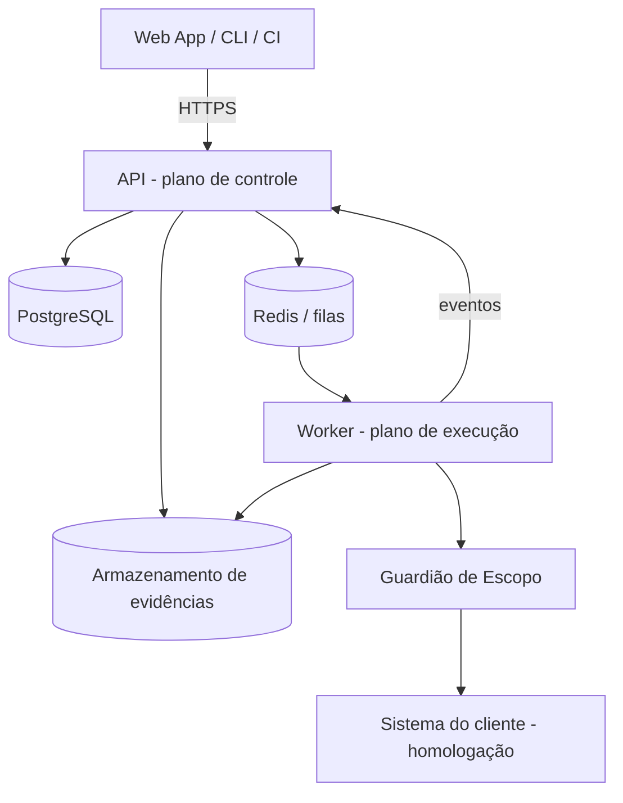

# Bastion — Plataforma de avaliação de segurança contínua

> Nome provisório. Este README é a fonte única de documentação do projeto.

## 1. Objetivo principal

SaaS que faz **avaliações de segurança autorizadas e contínuas** em sites, APIs, sistemas internos e apps com IA. O cliente cadastra um sistema, comprova que é dono dele, agenda ou dispara avaliações (inclusive pelo CI) e recebe **achados com evidência, severidade e correção sugerida**, mapeados para OWASP e LGPD.

Regras inegociáveis do produto:
- Só avalia sistemas com **propriedade comprovada** (DNS TXT, arquivo em `/.well-known/` ou cabeçalho com token).
- **Nunca produção**: só ambientes de homologação do cliente ou ambientes isolados criados pela plataforma.
- Todo tráfego de saída passa pelo **Guardião de Escopo**, e toda ação fica no **log de auditoria**.

## 2. Como rodar

Pré-requisitos: **Node ≥ 24** (há um `.nvmrc`) e pnpm via corepack (a versão fica fixada em `packageManager`).

Na primeira vez, em cada máquina, habilite o corepack. No Windows, isso pode exigir um terminal aberto como administrador:

```bash
corepack enable           # deixa o comando pnpm disponível no PATH, na versão fixada
```

```bash
pnpm install              # instala as dependências do monorepo
pnpm dev                  # protótipo em modo desenvolvimento, na porta 3000
pnpm build                # build de produção
pnpm typecheck            # verificação de tipos (TypeScript estrito)
pnpm lint                 # ESLint
```

> Sem `corepack enable`, `corepack pnpm dev` na raiz falha com "pnpm não é reconhecido", porque o script interno chama `pnpm`. Nesse caso, rode direto: `corepack pnpm --filter @bastion/web dev`.

Para continuar o desenvolvimento em outra máquina, veja a seção 9.2.

A **Fase 1 (protótipo navegável) não precisa de banco de dados nem de variáveis de ambiente**: os dados são fictícios e ficam em memória no navegador.

## 3. Tecnologias

### Em uso (Fase 1)

| Camada | Escolha |
|---|---|
| Monorepo | pnpm workspaces (`apps/*`, `packages/*`) |
| Linguagem | TypeScript 6.0 estrito (sem `any`) |
| Front | Next.js 16.4 (App Router, Turbopack) + React 19.3 |
| Estilo | CSS puro com tokens (`globals.css`), tema "Sinalização" |
| Qualidade | ESLint 9 (flat config do Next) |

### Planejadas (Fase 2)

| Camada | Escolha |
|---|---|
| API e worker | Node + Fastify |
| Banco | PostgreSQL (isolamento por organização) |
| Fila | BullMQ + Redis |
| Arquivos | S3 ou MinIO (MinIO no dev) |
| Dev local | Docker Compose (Postgres, Redis, MinIO) |
| Testes | Vitest (domínio) + Playwright (telas principais) |
| PDF | HTML para PDF com Playwright |

## 4. Arquitetura e decisões

### 4.1 Visão geral



- **Plano de controle:** contas, sistemas, avaliações, achados, relatórios e auditoria.
- **Plano de execução:** worker que consome a fila e executa os módulos de avaliação. Ele roda isolado e só fala com a internet pelo Guardião de Escopo.
- **Guardião de Escopo:** só libera requisições para alvos verificados da organização, aplica limite de taxa, bloqueia domínios declarados como produção e registra tudo.

### 4.2 Contextos delimitados (DDD) e estrutura de pastas

Organizar **por contexto de negócio**, não por tipo técnico.

| Contexto | Agregado raiz | Objetos de valor | Eventos |
|---|---|---|---|
| Contas e Acessos | `Organizacao` (+ `Membro`) | `Papel`, `Email` | `MembroConvidado` |
| Sistemas e Autorização | `Sistema` | `VerificacaoDePropriedade`, `Escopo`, `CredencialDeTeste` | `SistemaVerificado` |
| Avaliações | `Avaliacao` (+ `Etapa`) | `PerfilDeAvaliacao`, `EstadoDaAvaliacao`, `Agenda` | `AvaliacaoSolicitada`, `AvaliacaoConcluida` |
| Achados | `Achado` (+ `HistoricoDoAchado`) | `Severidade`, `Evidencia`, `ImpressaoDigital` | `AchadoCriado`, `AchadoCorrigido` |
| Relatórios | `Relatorio` | `NotaDeSeguranca`, `MapeamentoDeConformidade` | `RelatorioGerado` |
| Auditoria | `RegistroDeAuditoria` (só inclusão) | `Ator`, `Acao` | — |

```
apps/
  web/                    Next.js (telas)
  api/src/
    contas/  sistemas/  avaliacoes/  achados/  relatorios/  auditoria/
    integracoes/          (camada anticorrupção)
  worker/src/
    modulos/              módulos de avaliação
    guardiao-de-escopo/
packages/
  dominio-compartilhado/  tipos e objetos de valor comuns
```

Estrutura real de `apps/web/src` na Fase 1:

```
apps/web/src/
  app/                    rotas (App Router) e globals.css (tokens e classes)
    login/                /login
    (plataforma)/         layout com menu lateral + telas autenticadas
      painel/ sistemas/ avaliacoes/ achados/ relatorios/ integracoes/ equipe/ plano/
  componentes/            componentes compartilhados (MenuLateral, SeloDeEstado, NotaDeSeguranca...)
  prototipo/              domínio fictício em memória
    tipos.ts  erros.ts  maquinas-de-estado.ts  rotulos.ts  formatacao.ts  nota.ts
    armazem.ts  useArmazem.ts
    dados-ficticios/      dados semente, um arquivo por contexto
```

### 4.3 Ciclo de vida da avaliação (máquina de estados)

`RASCUNHO → AGUARDANDO_VERIFICACAO → NA_FILA → PREPARANDO → EM_EXECUCAO → ANALISANDO → CONCLUIDA | FALHOU | CANCELADA`

- Só o agregado `Avaliacao` muda o próprio estado. Transição inválida lança erro de domínio.
- Cada transição grava um evento (outbox) e um registro de auditoria.
- Limites: `PREPARANDO` tem tempo máximo de 20 min; `EM_EXECUCAO` tem tempo máximo por perfil e pode ser cancelada a qualquer momento (botão Parar).

### 4.4 Ciclo de vida do achado

`NOVO → CONFIRMADO → EM_CORRECAO → REVALIDANDO → CORRIGIDO | REABERTO | RISCO_ACEITO`

- `RISCO_ACEITO` exige justificativa, responsável e data de validade. Quando vence, volta para `CONFIRMADO`.
- Achados repetidos entre avaliações são agrupados pela `ImpressaoDigital` (sistema + tipo + local).

### 4.5 Decisões de arquitetura (ADRs)

| # | Contexto | Decisão | Consequência |
|---|---|---|---|
| 1 | Time pequeno, domínio ainda em descoberta | Monólito modular (API) + worker separado | Extrair serviços depois, começando pela execução |
| 2 | Worker comprometido não pode alcançar dados | Controle e execução em processos e redes separados; comunicação por fila | Mais uma peça para operar |
| 3 | Contextos precisam reagir a eventos sem acoplamento | Eventos de domínio com padrão outbox | Consumidores idempotentes |
| 4 | Isolamento entre clientes | `organizacao_id` em todas as tabelas + Row-Level Security | Toda consulta passa pelo contexto da organização |
| 5 | Nunca avaliar produção | Domínio de produção declarado entra na lista de bloqueio do Guardião | Cadastro de sistema exige esse campo |
| 6 | Tema "Sinalização" simples, de alto contraste e sem dependências; a rede do ambiente de build pode ser restrita | CSS puro com tokens em `globals.css`, sem Tailwind e sem `next/font` | Os tokens (únicas cores em hex) vivem em um só `:root`; o resto usa `var(--token)`. Classes utilitárias próprias (`.btn`, `.card`, `.tag`...) precisam ser mantidas à mão |
| 7 | Validar telas e fluxos antes de existir a API | Protótipo com dados fictícios em memória, usando as mesmas máquinas de estado e a mesma linguagem ubíqua do domínio | Telas migram para a API real trocando o armazém; tudo se perde ao recarregar a página |
| 8 | TypeScript 7.0 já existe, mas o ecossistema do Next 16 foi validado com a série 6 | Usar TypeScript 6.0 (`~6.0.3`) | Atualizar para 7.x só depois de confirmar a compatibilidade com Next e ESLint |

## 5. Escopo do MVP

### Fase 1: protótipo navegável
Telas em `apps/web` com **dados fictícios em memória**, no tema **Sinalização** (seção 7):
Login · Painel · Sistemas · Cadastro de sistema (com passo de verificação) · Nova avaliação · Avaliação ao vivo · Lista de achados · Detalhe do achado · Relatório · Integrações · Equipe e auditoria · Plano e cobrança.

### Fase 2: plataforma real
- Contas, organizações, membros e papéis (Dono, Admin, Analista, Desenvolvedor, Leitor). Login por e-mail e senha no MVP; OIDC depois.
- Cadastro de sistemas, verificação de propriedade e domínio de produção bloqueado.
- Avaliações com a máquina de estados, fila e progresso ao vivo (WebSocket ou SSE).
- **Primeiro módulo de avaliação, passivo e não intrusivo:** cabeçalhos de segurança HTTP, configuração TLS e certificado, flags de cookies (`Secure`, `HttpOnly`, `SameSite`) e exposição de informação de versão em cabeçalhos.
- Achados com deduplicação e ciclo de vida; nota de segurança de 0 a 100.
- Relatório HTML e PDF; auditoria; API pública `/v1` (seção 6).
- Testes unitários do domínio (máquinas de estado, objetos de valor, regras de escopo).

Plano de execução detalhado na seção 9.

### Fora do MVP
Módulos de IA (chatbots e agentes), ambientes isolados criados pela plataforma, integrações Jira, Teams e Slack, cobrança real e SSO SAML.

## 6. API pública (planejada)

| Rota | Descrição | Resposta |
|---|---|---|
| `POST /v1/sistemas` | Cadastra sistema (tipo, URL de homologação, domínio de produção) | `201 { id, estadoVerificacao }` |
| `POST /v1/sistemas/{id}/verificacao` | Confere a prova de propriedade | `{ verificado, expiraEm }` |
| `POST /v1/avaliacoes` | Dispara avaliação (`sistemaId`, `perfil`, `notaMinima`) | `202 { id, estado }` |
| `GET /v1/avaliacoes/{id}` | Estado, progresso e nota | `{ estado, progresso, nota }` |
| `POST /v1/avaliacoes/{id}/parar` | Cancela a avaliação | `{ estado: "CANCELADA" }` |
| `GET /v1/avaliacoes/{id}/achados` | Achados paginados, com filtro por severidade | `{ itens[], proximaPagina }` |
| `POST /v1/achados/{id}/revalidar` | Reavalia um achado | `202 { avaliacaoId }` |
| `PATCH /v1/achados/{id}` | Muda o estado (ex.: risco aceito) | `{ estado }` |
| `GET /v1/relatorios/{id}` | Relatório em JSON ou PDF | JSON ou `application/pdf` |

Webhooks de saída: `avaliacao.concluida`, `avaliacao.falhou`, `achado.criado` e `achado.corrigido`, assinados com HMAC-SHA256 e com ID de evento para idempotência.

## 7. Identidade visual: tema "Sinalização"

Alto contraste, preto e amarelo, cantos retos, títulos em fonte monoespaçada e maiúsculas. **No código, usar sempre `var(--token)`, nunca hex solto.** Os tokens ficam definidos uma única vez em `globals.css`.

```css
:root {
  --bg: #111111;        --surface: #1A1A1A;   --surface-2: #242424;  --border: #3A3A3A;
  --text: #F2F2F2;      --text-2: #B0B0B0;    --muted: #777777;
  --accent: #FFD60A;    /* ação principal (CTA) */
  --accent-2: #FFFFFF;  /* secundária */
  --on-accent: #111111;
  --danger: #FF5C5C;    --warning: #FF9F1C;   --success: #3DDC84;    --info: #5AB0FF;
  --radius: 0;
  --font-body: system-ui, "Segoe UI", Roboto, Helvetica, Arial, sans-serif;
  --font-head: "Cascadia Code", Consolas, monospace;  /* títulos em MAIÚSCULAS */
}
/* Severidade: Crítica=--danger · Alta=--warning · Média=--info · Baixa=--muted */
```

Componentes básicos: `.btn` (`btn-cta`, `btn-outline`, `btn-danger`, `btn-sm`), `.card`, `.tag` de severidade, `.alert` (`info`/`success`/`warning`/`error`), `.table` e `.field`/`.input`/`.label`/`.hint`. Sem gradientes, sem brilho, sem emojis como ícone.

## 8. Guia do usuário

> O guia completo da plataforma real (cadastrar sistema, verificar propriedade, disparar avaliação, tratar achados, gerar relatório e integrar ao CI) virá na Fase 2. Abaixo, o roteiro do protótipo navegável da Fase 1.

### Roteiro do protótipo (Fase 1)

Rode `pnpm dev` (veja a seção 2) e abra a porta 3000. Os dados são fictícios, ficam só na memória do navegador e voltam ao início ao recarregar a página.

| Tela | Rota | O que fazer |
|---|---|---|
| Login | `/login` | Use qualquer e-mail válido e senha não vazia. |
| Painel | `/painel` | Veja nota média, achados em aberto por severidade, sistemas verificados e pendentes, avaliações recentes. Botão "Nova avaliação". |
| Sistemas | `/sistemas` | Lista de sistemas com estado da verificação de propriedade. |
| Cadastro de sistema | `/sistemas/novo` | Informe nome, tipo, URL de homologação (https) e domínio de produção; siga o passo de verificação (DNS TXT, arquivo em `/.well-known/` ou cabeçalho HTTP). Hosts com "falha" simulam verificação que falha. |
| Nova avaliação | `/avaliacoes/nova` | Escolha um sistema verificado, perfil Passivo, agenda e nota mínima. |
| Avaliação ao vivo | `/avaliacoes/{id}` | Acompanhe etapas, requisições do Guardião de Escopo (inclusive bloqueios) e use "Parar". |
| Lista de achados | `/achados` | Filtre por severidade e estado. |
| Detalhe do achado | `/achados/{id}` | Evidência, correção sugerida, OWASP/LGPD, histórico; mude o estado (risco aceito exige justificativa, responsável e validade). |
| Relatório | `/relatorios/{id}` | Nota, resumo e achados da avaliação. |
| Integrações | `/integracoes` | Chaves de API (segredo mostrado uma só vez) e webhooks de saída. |
| Equipe e auditoria | `/equipe` | Convide membros, altere papéis e consulte o log de auditoria. |
| Plano e cobrança | `/plano` | Limites, uso e faturas do plano fictício. |

## 9. Plano da Fase 2 (plataforma real)

> **Status: aguardando aprovação.** Este plano foi escrito em 2026-11-11, ao fim da Fase 1, para ser retomado em qualquer máquina. Antes de executar, confirme as perguntas em aberto (9.10). Quando a Fase 2 terminar, esta seção vira histórico e o conteúdo definitivo migra para as seções 2 a 8.

### 9.1 Objetivo

Trocar o protótipo em memória pela plataforma real:
- API Fastify (plano de controle) e worker (plano de execução), com Postgres, Redis e MinIO via Docker Compose;
- contextos DDD da seção 4.2, organizados por pasta de negócio;
- máquinas de estado da avaliação e do achado testadas com Vitest;
- verificação de propriedade e Guardião de Escopo bloqueando domínios de produção;
- primeiro módulo de avaliação, só passivo;
- achados com deduplicação, relatório HTML/PDF, auditoria e API `/v1`.

### 9.2 Retomar em outra máquina

```bash
git clone https://github.com/Le3Dev/bastion.git
cd bastion
git checkout feature/prototipo-navegavel   # ou main, depois do merge do PR da Fase 1
corepack enable                            # uma vez por máquina (veja a seção 2)
pnpm install
pnpm dev                                   # protótipo na porta 3000
```

- **Pré-requisitos extras da Fase 2:** Docker Desktop (Compose v2) e o Chromium do Playwright (`pnpm exec playwright install chromium`).
- **Branches:** uma branch e um PR por leva (ex.: `feature/fase2-dominio`, `feature/fase2-api-nucleo`), sempre criadas a partir da `main` atualizada.
- **Commits:** Conventional Commits em português, um por feature. Nunca commit direto na `main`.

### 9.3 Estrutura alvo

```
apps/
  web/                         Next.js (as telas passam a consumir a API)
  api/
    migracoes/                 SQL versionado
    src/
      contas/ sistemas/ avaliacoes/ achados/ relatorios/ auditoria/
        dominio/               agregados, objetos de valor, eventos e regras (sem framework)
        aplicacao/             casos de uso
        infraestrutura/        repositórios (Kysely) e rotas (Fastify)
      integracoes/             camada anticorrupção: filas do worker, armazenamento de evidências
      compartilhado/           config, erros HTTP, contexto da organização (RLS), outbox
      servidor.ts
  worker/src/
    guardiao-de-escopo/        regras de escopo + cliente HTTP protegido
    modulos/passivo/           cabeçalhos, TLS, cookies, exposição de versão
    tarefas/                   consumidores das filas
packages/
  dominio-compartilhado/       ErroDeDominio, Email, Severidade, ImpressaoDigital, Papel
  contratos/                   esquemas Zod e tipos da API /v1 e das mensagens das filas
infra/
  alvo-de-teste/               nginx propositalmente mal configurado, único alvo dos testes ponta a ponta
docker-compose.yml             postgres, redis, minio, alvo-de-teste
```

### 9.4 Decisões propostas (viram ADRs 9 em diante ao executar)

| Tema | Proposta | Motivo |
|---|---|---|
| Acesso a dados | Kysely + `pg`, migrações em SQL versionado | SQL explícito e tipado; `SET LOCAL app.organizacao_id` por transação alimenta o RLS |
| Contratos | Zod 4 em `packages/contratos` + `fastify-type-provider-zod` | O mesmo esquema valida a API e tipa o web e o worker |
| Sessão web | Cookie de sessão opaco (`HttpOnly`, `Secure`, `SameSite=Lax`), guardado como hash no banco; senha com Argon2id | Revogável, sem token no JavaScript do navegador |
| API pública e CI | Chave `bst_...` em `Authorization: Bearer`, guardada só como hash SHA-256, ligada à organização e a um papel | O segredo aparece uma única vez, como no protótipo |
| Progresso ao vivo | SSE em `GET /v1/avaliacoes/{id}/eventos` | Fluxo unidirecional, simples e sem biblioteca extra |
| Fila | BullMQ: `avaliacoes`, `verificacoes` e `webhooks` (API → worker); `resultados` (worker → API) | Reentrega, novas tentativas e consumo idempotente |
| Worker sem dados (ADR 2) | O worker não recebe credenciais de Postgres nem de MinIO. A tarefa traz alvo, escopo e limites, e URLs pré-assinadas para enviar evidências | Um worker comprometido não lê dados de clientes |
| Saída só pelo Guardião | A verificação de propriedade e a entrega de webhooks também rodam no worker. A API só assina o corpo do webhook (HMAC-SHA256) | Cumpre a regra "todo tráfego de saída passa pelo Guardião" |
| PDF | Playwright/Chromium na API, renderizando o HTML do relatório sem acesso à rede; o PDF fica no MinIO | Menos peças no MVP |
| Testes | Vitest (domínio, Guardião, módulo passivo, integração com o Postgres do Compose) + Playwright (fluxo principal no web) | Segue a seção 3 |

Versões conferidas em 2026-11-11 (confirmar com `npm view` antes de instalar): Fastify 5.12, BullMQ 6.7, ioredis 6.0, Kysely 0.29, pg 8.23, Zod 4.6, fastify-type-provider-zod 7.0, Vitest 5.1, Playwright 1.65, undici 8.12, @aws-sdk/client-s3 3.x, @node-rs/argon2 2.2, tsx 4.23.

### 9.5 Contrato entre API e worker

| Fila | Sentido | Tarefa ou evento | Conteúdo principal |
|---|---|---|---|
| `avaliacoes` | API → worker | `executar-avaliacao` | `avaliacaoId`, `organizacaoId`, `perfil`, `urlDeHomologacao`, `escopo { hostsPermitidos, dominiosBloqueados, requisicoesPorSegundo, tempoMaximoMs }`, URLs pré-assinadas de evidência |
| `verificacoes` | API → worker | `verificar-propriedade` | `sistemaId`, `metodo`, `token`, `urlDeHomologacao` |
| `webhooks` | API → worker | `entregar-webhook` | `entregaId`, `url`, `corpo`, `assinatura`, `eventoId` |
| `resultados` | worker → API | `etapa-atualizada`, `requisicao-do-guardiao`, `constatacao`, `avaliacao-finalizada`, `avaliacao-falhou`, `verificacao-concluida`, `entrega-concluida` | Todos com `idDoEvento`, para a API consumir de forma idempotente |

**Parar avaliação:** a API muda o estado para `CANCELADA` e publica um sinal de cancelamento no Redis. O worker confere o sinal entre requisições e encerra.

### 9.6 Guardião de Escopo: requisitos

- **Escopo:** libera só os hosts verificados da organização que vieram no escopo da tarefa. Bloqueia o domínio de produção declarado e todos os seus subdomínios.
- **DNS e IPs:** resolve o DNS e rejeita IPs privados, de loopback, link-local, de metadados de nuvem (`169.254.169.254`) e IPv6 locais. Conecta no IP já validado, o que impede DNS rebinding.
- **Redirecionamentos:** segue redirecionamentos manualmente, revalidando cada salto, com limite de saltos.
- **Perfil passivo:** só `GET` e `HEAD`, limite de taxa por host (padrão: 5 req/s), tempo limite por requisição e tamanho máximo de resposta.
- **Registro:** toda decisão (permitida ou bloqueada, com motivo) vira o evento `requisicao-do-guardiao`, gravado na avaliação e na auditoria.
- **Desenvolvimento:** `GUARDIAO_PERMITIR_REDES_PRIVADAS=true` libera a rede local só para o alvo de teste do Compose. Em produção essa variável é proibida.

### 9.7 Subtarefas por leva

No máximo 3 executores por leva, nunca dois no mesmo arquivo. Cada leva termina com typecheck, lint, testes e build verdes, commits por feature e push.

**Leva 1: domínio puro, contratos e infraestrutura (em paralelo)**

| Executor | Escopo | Arquivos |
|---|---|---|
| D | `packages/dominio-compartilhado` e `packages/contratos` (Zod da API `/v1` e das mensagens das filas). Domínio de Avaliações (máquina de estados com limite de 20 min em `PREPARANDO` e tempo máximo por perfil), Achados (máquina de estados, risco aceito com vencimento, deduplicação por `ImpressaoDigital`) e Relatórios (`NotaDeSeguranca`, `MapeamentoDeConformidade`), com testes. Configuração de `apps/api` | `packages/**`, `apps/api/src/{avaliacoes,achados,relatorios}/dominio/**`, `apps/api/{package.json,tsconfig.json,vitest.config.ts}` |
| E | Domínio de Contas (`Organizacao`, `Membro`, `Papel`, `ChaveDeApi`, `WebhookDeSaida`), Sistemas (`Sistema`, `VerificacaoDePropriedade`, `Escopo` com domínio de produção obrigatório) e Auditoria (`RegistroDeAuditoria`, só inclusão), com testes. No worker: regras puras do Guardião e analisadores do módulo passivo (respostas e handshakes entram, constatações saem), testados com fixtures. Configuração de `apps/worker` | `apps/api/src/{contas,sistemas,auditoria}/dominio/**`, `apps/worker/**` |
| F | `docker-compose.yml` (Postgres, Redis, MinIO, alvo de teste), `.env.example` e `infra/alvo-de-teste/**`. Migrações SQL: todas as tabelas com `organizacao_id` e RLS; papéis `bastion_migrador` (dono) e `bastion_app` (sem BYPASSRLS); auditoria protegida contra UPDATE e DELETE; tabela de outbox. README seção 2 (como rodar com o Compose e as variáveis de ambiente) | `docker-compose.yml`, `.env.example`, `infra/**`, `apps/api/migracoes/**`, `README.md` |

D e E trabalham em paralelo. Por isso, a API de `packages/dominio-compartilhado` fica combinada antes:
- `ErroDeDominio(mensagem, codigo)`;
- `Email.criar(valor)` com `.valor`;
- `Severidade`, `Papel` e `ImpressaoDigital.de(sistemaId, tipo, local)`.

**Leva 2: aplicação e integrações**

| Executor | Escopo | Arquivos |
|---|---|---|
| G | API núcleo: bootstrap Fastify, com tratamento de erros e mensagens claras, rate limit e CORS para o web. Também: Kysely + contexto da organização por transação (RLS), executor de migrações, autenticação (sessão e chave de API); aplicação, repositórios e rotas de Contas, Sistemas (`POST /v1/sistemas` e `/verificacao`) e Auditoria; chaves de API e webhooks; outbox e publicador, produtor das filas e consumidor de `verificacao-concluida`. Testes de integração no Postgres do Compose | `apps/api/src/{compartilhado,contas,sistemas,auditoria}/{aplicacao,infraestrutura}/**`, `apps/api/src/integracoes/**`, `apps/api/src/servidor.ts`, `apps/api/package.json` |
| H | Worker: consumidores BullMQ (`executar-avaliacao`, `verificar-propriedade`, `entregar-webhook`) e cliente HTTP do Guardião (undici com DNS fixado). Também: execução do módulo passivo com os analisadores da leva 1, sinal de cancelamento, envio de evidências por URL pré-assinada e eventos na fila `resultados`. Testes contra o alvo de teste | `apps/worker/**` |
| I | Web, parte 1: cliente da API tipado por `packages/contratos`, sessão (entrar, sair, guarda das rotas autenticadas). Telas Login, Painel, Sistemas, Cadastro de sistema, Equipe e auditoria e Integrações passam a consumir a API | `apps/web/src/api/**`, essas rotas, `apps/web/package.json` |

**Leva 3: avaliações, achados e relatórios de ponta a ponta**

| Executor | Escopo | Arquivos |
|---|---|---|
| J | API: Avaliações (`POST /v1/avaliacoes`, `GET /{id}`, `/parar`, SSE `/eventos`, vigilância dos tempos máximos); Achados (lista paginada com filtro por severidade, `PATCH`, `/revalidar`, vencimento do risco aceito); consumidor da fila `resultados` (persistência idempotente, deduplicação, nota); Relatórios (JSON, HTML e PDF); eventos `avaliacao.*` e `achado.*` no outbox para os webhooks. README seção 6 com todos os endpoints | `apps/api/src/{avaliacoes,achados,relatorios}/{aplicacao,infraestrutura}/**`, registro das rotas em `servidor.ts`, `README.md` |
| K | Web, parte 2: Nova avaliação, Avaliação ao vivo (SSE), Lista e Detalhe de achados, Relatório (PDF real) e Plano. Também: remoção do armazém fictício (`src/prototipo`), testes Playwright do fluxo principal (entrar → cadastrar o alvo de teste → verificar → avaliar → tratar achado → baixar relatório) e README seção 8 (guia do usuário completo) | demais rotas de `apps/web`, `apps/web/src/prototipo/**`, `apps/web/e2e/**` |

**Leva 4: verificação integrada.** `docker compose up -d`, migrações, `pnpm typecheck`, `pnpm lint`, `pnpm test`, `pnpm build` e o fluxo ponta a ponta contra o alvo de teste. Por fim, correções pontuais e o PR de cada leva.

### 9.8 Testes unitários previstos (Vitest)

- **Avaliação:**
  - transições válidas e inválidas;
  - cancelamento a partir de qualquer estado não final;
  - `PREPARANDO` acima de 20 min vira `FALHOU`;
  - tempo máximo por perfil;
  - eventos emitidos.
- **Achado:**
  - transições;
  - `RISCO_ACEITO` exige justificativa, responsável e data futura;
  - no vencimento, volta para `CONFIRMADO`;
  - `CORRIGIDO` vira `REABERTO` quando o achado reaparece.
- **Deduplicação:** a mesma impressão digital agrupa e soma ocorrências; sistema, tipo ou local diferentes não agrupam.
- **Nota de segurança:** pesos por severidade, limites 0 e 100, achados corrigidos e com risco aceito fora da conta.
- **Sistema:**
  - domínio de produção obrigatório;
  - homologação igual ao domínio de produção, ou subdomínio dele, é rejeitada;
  - a verificação expira.
- **Guardião:**
  - host não verificado é bloqueado;
  - o domínio de produção e seus subdomínios são bloqueados;
  - IP privado, loopback, link-local e metadados são bloqueados;
  - DNS que resolve para IP privado é bloqueado;
  - redirecionamento para fora do escopo é bloqueado;
  - limite de taxa;
  - métodos fora de `GET`/`HEAD` são recusados no perfil passivo.
- **Módulo passivo:**
  - fixtures de cabeçalhos geram as constatações esperadas;
  - parsing de `Set-Cookie`;
  - detecção de versão em `Server`, `X-Powered-By` e afins;
  - TLS 1.0/1.1 aceito e certificado perto de vencer.
- **Webhooks:** a assinatura HMAC é determinística e a verificação usa `timingSafeEqual`.
- **Auditoria:** o repositório não expõe alteração nem remoção, e o banco recusa UPDATE e DELETE.

### 9.9 Riscos

- **RLS:** só isola de fato se a aplicação usar `bastion_app` (sem BYPASSRLS, não dono das tabelas). O login precisa achar o usuário antes de existir o contexto da organização: tabela `usuarios` global sem RLS, ou função `SECURITY DEFINER`.
- **SSRF e DNS rebinding:** valem para o Guardião e para a entrega de webhooks, inclusive nos redirecionamentos.
- **Playwright:** o Chromium pesa (~150 MB) e precisa de `playwright install` em cada máquina e na imagem da API.
- **Versões novas:** confirmar BullMQ 6 × ioredis 6, Vitest 5 e TypeScript 6 antes de fixar.
- **Só alvos autorizados:** os testes ponta a ponta usam apenas o alvo de teste local; nunca sites de terceiros.
- **PRs grandes:** um PR por leva, e avisar um revisor antes dos maiores (política de PR).
- **Windows:** requer Docker Desktop com WSL2, e as portas 3000 (web), 3333 (API), 5432, 6379, 9000/9001 (MinIO) e 8443 (alvo de teste) livres.

### 9.10 Perguntas em aberto (confirmar ao aprovar)

1. Acesso a dados: Kysely (recomendado), Drizzle ou Prisma?
2. Sessão web: cookie opaco (recomendado) ou JWT?
3. Depois da integração: remover o armazém fictício (recomendado) ou manter um "modo demonstração" por variável de ambiente?
4. PDF: na própria API (recomendado no MVP) ou num serviço separado?
5. Agendamento recorrente: entra na Fase 2 ou fica para depois (só disparo manual e pelo CI)?

### 9.11 Pendências herdadas da Fase 1

- `pnpm dev` na raiz depende de `corepack enable` (seção 2).
- `apps/web/AGENTS.md` é gerado pelo `next dev` e está no `.gitignore`.
- Ainda não há testes automatizados das telas; o Playwright entra na leva 3.
