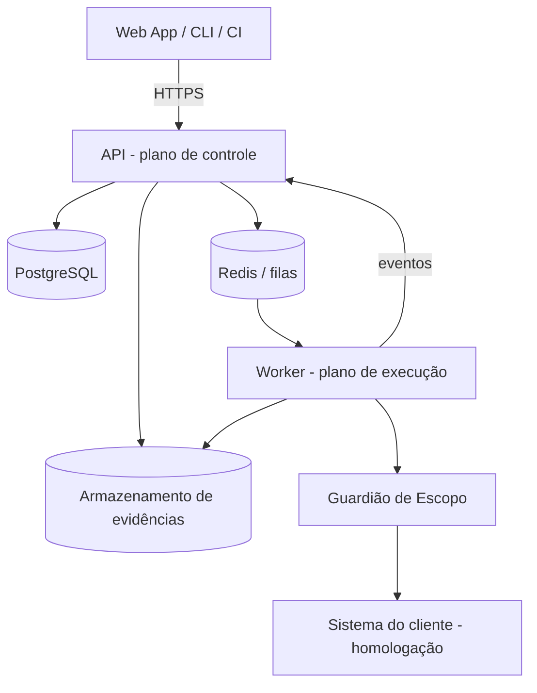

# Bastion — Plataforma de avaliação de segurança contínua

> Nome provisório. Este README é a fonte única de documentação do projeto.

## 1. Objetivo principal

SaaS que faz **avaliações de segurança autorizadas e contínuas** em sites, APIs, sistemas internos e apps com IA. O cliente cadastra um sistema, comprova que é dono dele, agenda ou dispara avaliações (inclusive pelo CI) e recebe **achados com evidência, severidade e correção sugerida**, mapeados para OWASP e LGPD.

Regras inegociáveis do produto:
- Só avalia sistemas com **propriedade comprovada** (DNS TXT, arquivo em `/.well-known/` ou cabeçalho com token).
- **Nunca produção**: só ambientes de homologação do cliente ou ambientes isolados criados pela plataforma.
- Todo tráfego de saída passa pelo **Guardião de Escopo**, e toda ação fica no **log de auditoria**.

## 2. Como rodar

Pré-requisitos: **Node ≥ 24** (há um `.nvmrc`) e pnpm via corepack (a versão fica fixada em `packageManager`).

```bash
corepack pnpm install     # instala as dependências do monorepo
corepack pnpm dev         # protótipo em modo desenvolvimento, na porta 3000
corepack pnpm build       # build de produção
corepack pnpm typecheck   # verificação de tipos (TypeScript estrito)
corepack pnpm lint        # ESLint
```

A **Fase 1 (protótipo navegável) não precisa de banco de dados nem de variáveis de ambiente**: os dados são fictícios e ficam em memória no navegador.

## 3. Tecnologias

### Em uso (Fase 1)

| Camada | Escolha |
|---|---|
| Monorepo | pnpm workspaces (`apps/*`, `packages/*`) |
| Linguagem | TypeScript 6.0 estrito (sem `any`) |
| Front | Next.js 16.4 (App Router, Turbopack) + React 19.3 |
| Estilo | CSS puro com tokens (`globals.css`), tema "Sinalização" |
| Qualidade | ESLint 9 (flat config do Next) |

### Planejadas (Fase 2)

| Camada | Escolha |
|---|---|
| API e worker | Node + Fastify |
| Banco | PostgreSQL (isolamento por organização) |
| Fila | BullMQ + Redis |
| Arquivos | S3 ou MinIO (MinIO no dev) |
| Dev local | Docker Compose (Postgres, Redis, MinIO) |
| Testes | Vitest (domínio) + Playwright (telas principais) |
| PDF | HTML para PDF com Playwright |

## 4. Arquitetura e decisões

### 4.1 Visão geral



- **Plano de controle:** contas, sistemas, avaliações, achados, relatórios e auditoria.
- **Plano de execução:** worker que consome a fila e executa os módulos de avaliação. Ele roda isolado e só fala com a internet pelo Guardião de Escopo.
- **Guardião de Escopo:** só libera requisições para alvos verificados da organização, aplica limite de taxa, bloqueia domínios declarados como produção e registra tudo.

### 4.2 Contextos delimitados (DDD) e estrutura de pastas

Organizar **por contexto de negócio**, não por tipo técnico.

| Contexto | Agregado raiz | Objetos de valor | Eventos |
|---|---|---|---|
| Contas e Acessos | `Organizacao` (+ `Membro`) | `Papel`, `Email` | `MembroConvidado` |
| Sistemas e Autorização | `Sistema` | `VerificacaoDePropriedade`, `Escopo`, `CredencialDeTeste` | `SistemaVerificado` |
| Avaliações | `Avaliacao` (+ `Etapa`) | `PerfilDeAvaliacao`, `EstadoDaAvaliacao`, `Agenda` | `AvaliacaoSolicitada`, `AvaliacaoConcluida` |
| Achados | `Achado` (+ `HistoricoDoAchado`) | `Severidade`, `Evidencia`, `ImpressaoDigital` | `AchadoCriado`, `AchadoCorrigido` |
| Relatórios | `Relatorio` | `NotaDeSeguranca`, `MapeamentoDeConformidade` | `RelatorioGerado` |
| Auditoria | `RegistroDeAuditoria` (só inclusão) | `Ator`, `Acao` | — |

```
apps/
  web/                    Next.js (telas)
  api/src/
    contas/  sistemas/  avaliacoes/  achados/  relatorios/  auditoria/
    integracoes/          (camada anticorrupção)
  worker/src/
    modulos/              módulos de avaliação
    guardiao-de-escopo/
packages/
  dominio-compartilhado/  tipos e objetos de valor comuns
```

Estrutura real de `apps/web/src` na Fase 1:

```
apps/web/src/
  app/                    rotas (App Router) e globals.css (tokens e classes)
    login/                /login
    (plataforma)/         layout com menu lateral + telas autenticadas
      painel/ sistemas/ avaliacoes/ achados/ relatorios/ integracoes/ equipe/ plano/
  componentes/            componentes compartilhados (MenuLateral, SeloDeEstado, NotaDeSeguranca...)
  prototipo/              domínio fictício em memória
    tipos.ts  erros.ts  maquinas-de-estado.ts  rotulos.ts  formatacao.ts  nota.ts
    armazem.ts  useArmazem.ts
    dados-ficticios/      dados semente, um arquivo por contexto
```

### 4.3 Ciclo de vida da avaliação (máquina de estados)

`RASCUNHO → AGUARDANDO_VERIFICACAO → NA_FILA → PREPARANDO → EM_EXECUCAO → ANALISANDO → CONCLUIDA | FALHOU | CANCELADA`

- Só o agregado `Avaliacao` muda o próprio estado. Transição inválida lança erro de domínio.
- Cada transição grava um evento (outbox) e um registro de auditoria.
- Limites: `PREPARANDO` tem tempo máximo de 20 min; `EM_EXECUCAO` tem tempo máximo por perfil e pode ser cancelada a qualquer momento (botão Parar).

### 4.4 Ciclo de vida do achado

`NOVO → CONFIRMADO → EM_CORRECAO → REVALIDANDO → CORRIGIDO | REABERTO | RISCO_ACEITO`

- `RISCO_ACEITO` exige justificativa, responsável e data de validade. Quando vence, volta para `CONFIRMADO`.
- Achados repetidos entre avaliações são agrupados pela `ImpressaoDigital` (sistema + tipo + local).

### 4.5 Decisões de arquitetura (ADRs)

| # | Contexto | Decisão | Consequência |
|---|---|---|---|
| 1 | Time pequeno, domínio ainda em descoberta | Monólito modular (API) + worker separado | Extrair serviços depois, começando pela execução |
| 2 | Worker comprometido não pode alcançar dados | Controle e execução em processos e redes separados; comunicação por fila | Mais uma peça para operar |
| 3 | Contextos precisam reagir a eventos sem acoplamento | Eventos de domínio com padrão outbox | Consumidores idempotentes |
| 4 | Isolamento entre clientes | `organizacao_id` em todas as tabelas + Row-Level Security | Toda consulta passa pelo contexto da organização |
| 5 | Nunca avaliar produção | Domínio de produção declarado entra na lista de bloqueio do Guardião | Cadastro de sistema exige esse campo |
| 6 | Tema "Sinalização" simples, de alto contraste e sem dependências; a rede do ambiente de build pode ser restrita | CSS puro com tokens em `globals.css`, sem Tailwind e sem `next/font` | Os tokens (únicas cores em hex) vivem em um só `:root`; o resto usa `var(--token)`. Classes utilitárias próprias (`.btn`, `.card`, `.tag`...) precisam ser mantidas à mão |
| 7 | Validar telas e fluxos antes de existir a API | Protótipo com dados fictícios em memória, usando as mesmas máquinas de estado e a mesma linguagem ubíqua do domínio | Telas migram para a API real trocando o armazém; tudo se perde ao recarregar a página |
| 8 | TypeScript 7.0 já existe, mas o ecossistema do Next 16 foi validado com a série 6 | Usar TypeScript 6.0 (`~6.0.3`) | Atualizar para 7.x só depois de confirmar a compatibilidade com Next e ESLint |

## 5. Escopo do MVP

### Fase 1: protótipo navegável
Telas em `apps/web` com **dados fictícios em memória**, no tema **Sinalização** (seção 7):
Login · Painel · Sistemas · Cadastro de sistema (com passo de verificação) · Nova avaliação · Avaliação ao vivo · Lista de achados · Detalhe do achado · Relatório · Integrações · Equipe e auditoria · Plano e cobrança.

### Fase 2: plataforma real
- Contas, organizações, membros e papéis (Dono, Admin, Analista, Desenvolvedor, Leitor). Login por e-mail e senha no MVP; OIDC depois.
- Cadastro de sistemas, verificação de propriedade e domínio de produção bloqueado.
- Avaliações com a máquina de estados, fila e progresso ao vivo (WebSocket ou SSE).
- **Primeiro módulo de avaliação, passivo e não intrusivo:** cabeçalhos de segurança HTTP, configuração TLS e certificado, flags de cookies (`Secure`, `HttpOnly`, `SameSite`) e exposição de informação de versão em cabeçalhos.
- Achados com deduplicação e ciclo de vida; nota de segurança de 0 a 100.
- Relatório HTML e PDF; auditoria; API pública `/v1` (seção 6).
- Testes unitários do domínio (máquinas de estado, objetos de valor, regras de escopo).

### Fora do MVP
Módulos de IA (chatbots e agentes), ambientes isolados criados pela plataforma, integrações Jira, Teams e Slack, cobrança real e SSO SAML.

## 6. API pública (planejada)

| Rota | Descrição | Resposta |
|---|---|---|
| `POST /v1/sistemas` | Cadastra sistema (tipo, URL de homologação, domínio de produção) | `201 { id, estadoVerificacao }` |
| `POST /v1/sistemas/{id}/verificacao` | Confere a prova de propriedade | `{ verificado, expiraEm }` |
| `POST /v1/avaliacoes` | Dispara avaliação (`sistemaId`, `perfil`, `notaMinima`) | `202 { id, estado }` |
| `GET /v1/avaliacoes/{id}` | Estado, progresso e nota | `{ estado, progresso, nota }` |
| `POST /v1/avaliacoes/{id}/parar` | Cancela a avaliação | `{ estado: "CANCELADA" }` |
| `GET /v1/avaliacoes/{id}/achados` | Achados paginados, com filtro por severidade | `{ itens[], proximaPagina }` |
| `POST /v1/achados/{id}/revalidar` | Reavalia um achado | `202 { avaliacaoId }` |
| `PATCH /v1/achados/{id}` | Muda o estado (ex.: risco aceito) | `{ estado }` |
| `GET /v1/relatorios/{id}` | Relatório em JSON ou PDF | JSON ou `application/pdf` |

Webhooks de saída: `avaliacao.concluida`, `avaliacao.falhou`, `achado.criado` e `achado.corrigido`, assinados com HMAC-SHA256 e com ID de evento para idempotência.

## 7. Identidade visual: tema "Sinalização"

Alto contraste, preto e amarelo, cantos retos, títulos em fonte monoespaçada e maiúsculas. **No código, usar sempre `var(--token)`, nunca hex solto.** Os tokens ficam definidos uma única vez em `globals.css`.

```css
:root {
  --bg: #111111;        --surface: #1A1A1A;   --surface-2: #242424;  --border: #3A3A3A;
  --text: #F2F2F2;      --text-2: #B0B0B0;    --muted: #777777;
  --accent: #FFD60A;    /* ação principal (CTA) */
  --accent-2: #FFFFFF;  /* secundária */
  --on-accent: #111111;
  --danger: #FF5C5C;    --warning: #FF9F1C;   --success: #3DDC84;    --info: #5AB0FF;
  --radius: 0;
  --font-body: system-ui, "Segoe UI", Roboto, Helvetica, Arial, sans-serif;
  --font-head: "Cascadia Code", Consolas, monospace;  /* títulos em MAIÚSCULAS */
}
/* Severidade: Crítica=--danger · Alta=--warning · Média=--info · Baixa=--muted */
```

Componentes básicos: `.btn` (`btn-cta`, `btn-outline`, `btn-danger`, `btn-sm`), `.card`, `.tag` de severidade, `.alert` (`info`/`success`/`warning`/`error`), `.table` e `.field`/`.input`/`.label`/`.hint`. Sem gradientes, sem brilho, sem emojis como ícone.

## 8. Guia do usuário

> O guia completo da plataforma real (cadastrar sistema, verificar propriedade, disparar avaliação, tratar achados, gerar relatório e integrar ao CI) virá na Fase 2. Abaixo, o roteiro do protótipo navegável da Fase 1.

### Roteiro do protótipo (Fase 1)

Rode `corepack pnpm dev` e abra a porta 3000. Os dados são fictícios, ficam só na memória do navegador e voltam ao início ao recarregar a página.

| Tela | Rota | O que fazer |
|---|---|---|
| Login | `/login` | Use qualquer e-mail válido e senha não vazia. |
| Painel | `/painel` | Veja nota média, achados em aberto por severidade, sistemas verificados e pendentes, avaliações recentes. Botão "Nova avaliação". |
| Sistemas | `/sistemas` | Lista de sistemas com estado da verificação de propriedade. |
| Cadastro de sistema | `/sistemas/novo` | Informe nome, tipo, URL de homologação (https) e domínio de produção; siga o passo de verificação (DNS TXT, arquivo em `/.well-known/` ou cabeçalho HTTP). Hosts com "falha" simulam verificação que falha. |
| Nova avaliação | `/avaliacoes/nova` | Escolha um sistema verificado, perfil Passivo, agenda e nota mínima. |
| Avaliação ao vivo | `/avaliacoes/{id}` | Acompanhe etapas, requisições do Guardião de Escopo (inclusive bloqueios) e use "Parar". |
| Lista de achados | `/achados` | Filtre por severidade e estado. |
| Detalhe do achado | `/achados/{id}` | Evidência, correção sugerida, OWASP/LGPD, histórico; mude o estado (risco aceito exige justificativa, responsável e validade). |
| Relatório | `/relatorios/{id}` | Nota, resumo e achados da avaliação. |
| Integrações | `/integracoes` | Chaves de API (segredo mostrado uma só vez) e webhooks de saída. |
| Equipe e auditoria | `/equipe` | Convide membros, altere papéis e consulte o log de auditoria. |
| Plano e cobrança | `/plano` | Limites, uso e faturas do plano fictício. |
